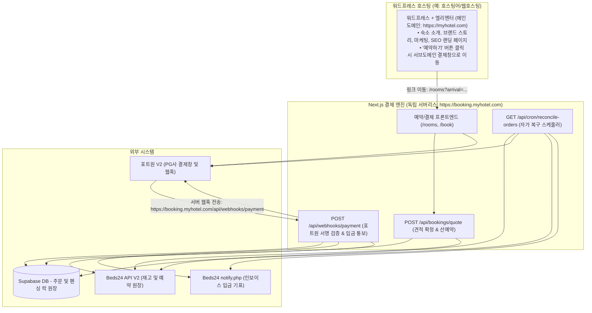
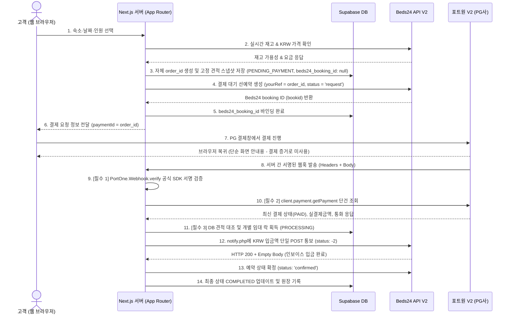
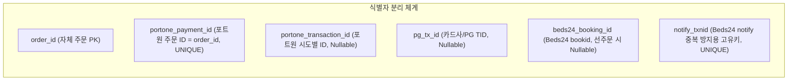
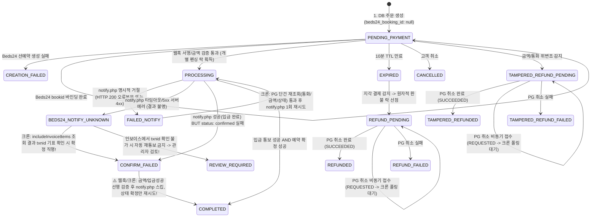

# Beds24 + 자체 결제 통합 엔지니어링 바이블 (Master Integration Guide)

> **문서 상태**: 📐 **엔지니어링 사양서 (Working Architectural Specification - v2.6)**  
> **검토 반영**: `BEDS24_PAYMENT_FLOW_REVIEW.md` 최신 검토안 전수 대조 및 해결책 완비:  
> 1. Beds24 예약금(Deposit) vs 숙박 총액(Total Price) 회계 분리 및 `notify.php` 실입금액 통보 규격  
> 2. 환율 기준 공식 규정 (1 USD당 KRW 환율 및 센트 정밀 반올림 계약)  
> 3. PG 채널 및 결제 수단별 3단계 순차 검증 로드맵 (국내 KRW -> 해외 USD -> PayPal)  
> 4. `CONFIRM_FAILED` 금액/통화/입금성공 선행 검증 및 원자적 선점 락  
> 5. `FAILED_NOTIFY` 크론 통화(`currency`) 및 주문 ID 대조 추가  
> 6. 포트원 `Idempotency-Key` 헤더와 `cancellationId` 취소 식별자 명확화  
> 7. Beds24 응답 오류 정밀 분류 (5xx 타임아웃 `Ambiguous` vs 200에러문구/4xx `Explicit`)  
> 8. Beds24 API V2 응답 스키마 성공 판정 조건 강화 (`item.success === true && item.id`)  
> 9. UNKNOWN 경로 txnid 미확인 시 자동 재통보 금지 및 `REVIEW_REQUIRED` 안전 격리  
> 10. 워드프레스(마케팅) vs Next.js(결제 API) 배포 도메인 및 호스팅 경계 명시  
> **적용 스택**: Next.js App Router (독립 API 서버), Beds24 API V2, 포트원(PortOne) V2 JS 서버 SDK (`@portone/server-sdk`), Supabase DB  
> **배포 주의**: 본 문서는 타 프로젝트(자체 결제 웹사이트/엔진) 구축용 레퍼런스이며, 실물 프로덕션 배포 전 PG 채널의 통화별 승인/정산 계약 및 Beds24 샌드박스 실측 통과가 필수입니다.

---

## 1. 시스템 아키텍처 및 통화 처리 계약

### 1.1 서비스 배포 및 도메인 경계 (Deployment Architecture)

워드프레스/엘리멘터 환경과 Next.js 자체 결제 엔진의 책임 및 호스팅 경계를 명확히 분리합니다:



* **메인 도메인 (`https://myhotel.com`)**: 워드프레스 + 엘리멘터로 구동. 고객 마케팅 및 SEO 전담.
* **예약 서브도메인 (`https://booking.myhotel.com`)**: Next.js App Router로 구동 (Vercel 또는 Node.js 독립 컨테이너). 결제 보안(PCI-DSS 대응), 환경변수 시크릿 보관, 웹훅 및 크론 수신 전담.
* **웹훅 수신 URL**: `https://booking.myhotel.com/api/webhooks/payment`
* **크론 실행 방식**: Vercel Cron 또는 Supabase `pg_cron`에서 `Authorization: Bearer ${CRON_SECRET}` 헤더를 탑재하여 매 5분마다 호출.

---

### 1.2 엔드투엔드 시퀀스 다이어그램 (End-to-End Sequence)



---

### 1.3 예약금(Deposit) 분할 결제 모델 및 환율 계산 공식

#### ① 예약금(Deposit) vs 숙박 총액(Total Price) 회계 분리 원칙
숙소 운영 정책에 따라 **100% 전액 선결제**를 받을 수도 있고, **10% 또는 1박 요금만 예약금(보증금)**으로 받고 잔금은 체크인 시 현장 결제할 수도 있습니다. 이 경우 Beds24 인보이스와 결제 금액을 엄격히 구분해야 합니다:

* **Beds24 예약 생성 (`createBeds24Booking`)**:
  * `price` 필드에는 **숙박 총 요금(`total_price_krw`, 예: 1,000,000원)**을 전송합니다.
  * Beds24 인보이스의 `Total Charges`에 전체 숙박 요금이 등록됩니다.
* **PG 결제창 청구 (`expected_amount`, `currency`)**:
  * 고객이 결제할 금액은 정책에 따른 **예약금액(`deposit_amount_krw`, 예: 10%인 100,000원)**입니다.
* **Beds24 입금 통보 (`notify.php`)**:
  * ⚠️ `amount` 파라미터에는 숙박 총액이 아니라 **실제 수납된 예약금(`deposit_amount_krw`, 100,000원)**을 전송해야 합니다!
  * Beds24 인보이스 자동 계산:
    $$\text{Balance Due (현장 결제 잔금)} = \text{Total Charges (객실 총액)} - \text{Payments (notify.php 통보액)}$$
  * **회계 오류 경고**: 만약 10% 예약금만 수납했는데 `notify.php`에 숙박 총액(1,000,000원)을 보내버리면, 인보이스상 잔금(`Balance Due`)이 0원으로 완납 처리되어 현장 잔금을 청구할 수 없는 치명적인 운영 사고가 발생합니다.

#### ② 환율 정의 및 센트 반올림 공식 (Exchange Rate Standard)
* **환율의 정의**: **"1 USD당 원화(KRW) 환율"** (Base: USD, Quote: KRW, 예: `1,420.50` KRW/USD).
* **계산 공식**:
  $$\text{USD 센트 정수} = \text{Math.round}\left(\frac{\text{예약금(KRW)}}{\text{환율(KRW/USD)}} \times 100\right)$$
  $$\text{USD 최종 청구액} = \frac{\text{USD 센트 정수}}{100} \quad (\text{소수점 셋째 자리에서 반올림하여 센트 단위 확정})$$
* **부동소수점 오차 방지**: JavaScript `number` 비교 시 센트 정수 단위(`Math.round(amount * 100)`)로 변환하여 대조합니다.

```typescript
/**
 * 💡 서버 고정 견적 스냅샷 생성 유틸리티 (예약금 비율 및 환율 공식 적용)
 * @param totalPriceKrw 객실 숙박 총 요금 (Beds24 예약 price 필드용)
 * @param depositRate 예약금 비율 (100 = 전액 완납, 10 = 10% 예약금)
 * @param exchangeRate 1 USD당 원화 환율 (예: 1420.50, 외부 실시간 환율 API 필수 주입)
 */
export function generateFixedQuotationSnapshot({
    totalPriceKrw,
    depositRate = 100,
    currency,
    exchangeRate,
}: {
    totalPriceKrw: number;
    depositRate?: number; // 기본값 100%
    currency: 'KRW' | 'USD';
    exchangeRate: number; // 1 USD당 KRW 환율 (필수 파라미터)
}) {
    if (exchangeRate <= 0) {
        throw new Error('유효하지 않은 환율입니다.');
    }
    if (depositRate <= 0 || depositRate > 100) {
        throw new Error('예약금 비율은 1% ~ 100% 사이여야 합니다.');
    }

    // 1. 원화 기준 실제 결제할 예약금 계산
    const depositAmountKrw = Math.round(totalPriceKrw * (depositRate / 100));

    if (currency === 'KRW') {
        return {
            total_price_krw: Math.round(totalPriceKrw), // Beds24 예약 총액
            deposit_rate: depositRate,                  // 예약금 비율 (예: 100% 또는 10%)
            deposit_amount_krw: depositAmountKrw,       // notify.php로 보낼 원화 예약금
            expected_amount: depositAmountKrw,          // PG사 청구 원화
            currency: 'KRW' as const,
            krw_amount: depositAmountKrw,               // Beds24 notify.php 통보액 (= depositAmountKrw)
            exchange_rate: 1.0,
            rate_fixed_at: new Date().toISOString(),
        };
    }

    // 2. USD 해외 결제: 1 USD당 KRW 환율 적용 및 센트 반올림
    const depositCents = Math.round((depositAmountKrw / exchangeRate) * 100);
    const usdAmount = depositCents / 100;

    return {
        total_price_krw: Math.round(totalPriceKrw),     // Beds24 예약 총액
        deposit_rate: depositRate,                      // 예약금 비율
        deposit_amount_krw: depositAmountKrw,           // 실제 수납된 원화 예약금
        expected_amount: usdAmount,                     // PG사 청구 달러 (예: $70.40)
        currency: 'USD' as const,
        krw_amount: depositAmountKrw,                   // Beds24 notify.php 통보액 (= depositAmountKrw)
        exchange_rate: exchangeRate,                    // 적용 환율 (KRW/USD)
        rate_fixed_at: new Date().toISOString(),
    };
}
```

---

## 2. Beds24 관리자 콘솔 설정의 실체 (경로별 구분)

Beds24 관리자 화면(`https://beds24.com`) 설정 시 **자체 개발 결제창 흐름과 Beds24 기본 예약창 흐름을 명확히 분리**해야 합니다.

### ① 자체 웹사이트 결제 시 (현재 구축 구조)
* 손님이 자체 개발한 Next.js 웹사이트에서 결제하고 서버가 `notify.php`만 호출하므로:
  * **필수 설정**: `Settings > Payments > Payment Gateways > Custom Gateway`의 **`Key` (비밀번호)** 하나뿐입니다.
  * **불필요한 설정**: `URL`과 `Post data`는 Beds24 예약 페이지에서 외부 결제창으로 넘길 때만 쓰는 것이므로, 자체 결제창 구조에서는 입력하지 않습니다. 임의 가짜 주소를 넣는 것은 권장하지 않습니다.
  * *(단, 미사용 게이트웨이를 높은 우선순위로 켜두면 Beds24 기본 예약창에 노출될 수 있으므로 주의합니다.)*

### ② 필수 사전 설정: Booking Rules 재고 차단 정책 (오버부킹 방어)
* **메뉴 위치**: `Settings > Properties > Booking Rules`
* **설정 항목**: **`Bookings with Request Status`**: **`Block room`** 선택 필수!
* *(이 설정이 활성화되어야 결제 대기 선예약(`status: 'request'`) 생성 즉시 Beds24 및 연결된 에어비앤비/아고다 캘린더가 닫힙니다.)*

### ③ Beds24 `notify.php` 파라미터 완전 명세 (Official Specification)

`POST https://api.beds24.com/custompaymentgateway/notify.php` (`Content-Type: application/x-www-form-urlencoded`)

| 파라미터명 | Beds24 공식 요건 | 우리 시스템 내부 계약 | 타입 | 설명 및 권장값 |
| :--- | :--- | :--- | :--- | :--- |
| **`key`** | **필수** | **필수** | string | Beds24 Custom Gateway 설정에 입력한 Key |
| **`bookid`** | **필수** | **필수** | number/string | Beds24 예약 고유 번호 (`bookingId`) |
| **`amount`** | 선택 | **필수** | number | 예약 기본 통화 기준 입금액 (KRW 정수) |
| **`txnid`** | 선택 | **필수** | string | 고유 거래 식별자 (`ord_${order_id}`, 멱등키) |
| **`status`** | 선택 | 선택 | number | 예약 상태 전이 제어 코드:<br>• **`-2` (권장)**: 상태 변경 없음 (입금만 처리)<br>• **`1`**: 확정 (`confirmed`)<br>• **`2`**: 신규 (`new`)<br>• **`3`**: 요청 (`request`)<br>• **`0`**: 취소 (`cancelled`) |
| **`payment_status`** | 선택 | 선택 | string | 인보이스 결제 상태 문구 |
| **`description`** | 선택 | 선택 | string | 인보이스 입금 라인 설명 (기본값: `'온라인 카드/간편결제'`) |

> ⚠️ **응답 판정 공식 규칙**:  
> 성공 시 HTTP 200 + **완전히 비어 있는 응답 본문(`trimmed.length === 0`)**이 반환됩니다.  
> Beds24는 오류 발생 시에도 HTTP 200을 반환하며 본문에 에러 문구를 담으므로, 본문에 텍스트가 있으면 무조건 에러로 처리해야 합니다.

---

## 3. 핵심 식별자 체계 및 프로덕션 Supabase DDL 계약

### 3.1 식별자 분리 체계



| DB 컬럼명 | 발급 주체 | 실제 의미 및 규칙 |
| :--- | :--- | :--- |
| **`order_id`** | 자체 서버 | • 자체 생성 주문 고유 ID (UUID / NanoID, PK)<br>• Beds24 `yourRef`로 전달<br>• 포트원 결제 요청 시 `paymentId`에 동일값 전달 |
| **`portone_payment_id`** | 자체 서버 | • 포트원에 등록한 고객사 주문 식별자 (`= order_id`, UNIQUE 제약) |
| **`portone_transaction_id`**| 포트원 | • 결제 시도별 포트원 고유 번호 (단건 조회 API의 `payment.transactionId`) |
| **`pg_tx_id`** | 실제 PG사 | • PG사(토스/나이스/엑심베이 등)가 발급한 실제 승인번호/TID (단건 조회 API에 있을 때만 저장, 없으면 null) |
| **`beds24_booking_id`** | Beds24 | • Beds24 고유 예약 ID (`bookid`)<br>• 선주문 생성 후 Beds24 API 응답을 받아 바인딩하므로 **초기 NULL 허용** |
| **`notify_txnid`** | 자체 서버 | • Beds24 `notify.php` 호출 시 전달하는 고유 거래 식별자 (`ord_${order_id}` 고유값 불변 재사용) |

### 3.2 프로덕션 Supabase DDL 마이그레이션 스크립트

```sql
-- Supabase orders 테이블 생성 DDL (v2.5)
CREATE TABLE IF NOT EXISTS public.orders (
    order_id TEXT PRIMARY KEY,                       -- 자체 주문 ID (UUID/NanoID)
    portone_payment_id TEXT NOT NULL UNIQUE,         -- 포트원 결제 ID (= order_id, 1:1 고유 보장)
    portone_transaction_id TEXT,                     -- 포트원 시도별 트랜잭션 ID (재시도 시 변동 가능)
    pg_tx_id TEXT,                                   -- 실제 PG사 거래번호(TID)
    beds24_booking_id BIGINT,                        -- Beds24 예약 ID (선주문 생성 시 NULL 허용 후 바인딩)
    notify_txnid TEXT NOT NULL UNIQUE,               -- Beds24 notify.php 전용 멱등 거래키 (불변)
    
    -- 금액 및 견적 스냅샷 (예약금 분할 결제 지원)
    total_price_krw INTEGER NOT NULL,                -- 숙박 총 요금 (Beds24 예약 price 등록용)
    deposit_rate NUMERIC(5, 2) NOT NULL DEFAULT 100.00, -- 예약금 수납 비율 (100.00 = 전액 완납, 10.00 = 10% 예약금)
    deposit_amount_krw INTEGER NOT NULL,             -- 실제 수납할 원화 예약금액
    expected_amount NUMERIC(12, 2) NOT NULL,         -- PG 청구 예정 금액 (USD 소수점 or KRW 정수)
    currency TEXT NOT NULL CHECK (currency IN ('KRW', 'USD')),
    krw_amount INTEGER NOT NULL,                     -- Beds24 notify.php 통보용 KRW 정수 금액 (= deposit_amount_krw)
    paid_amount NUMERIC(12, 2),                      -- 실제 결제 완료 금액
    paid_currency TEXT,                              -- 실제 결제 완료 통화
    exchange_rate NUMERIC(10, 4) NOT NULL,           -- 적용 환율 (1 USD당 KRW)
    rate_fixed_at TIMESTAMPTZ NOT NULL,              -- 환율 확정 시각
    
    -- 상태 머신 관리
    status TEXT NOT NULL DEFAULT 'PENDING_PAYMENT' CHECK (status IN (
        'PENDING_PAYMENT', 'PROCESSING', 'COMPLETED',
        'CONFIRM_FAILED', 'BEDS24_NOTIFY_UNKNOWN', 'FAILED_NOTIFY',
        'REVIEW_REQUIRED', 'CREATION_FAILED', 'EXPIRED', 'CANCELLED',
        'REFUND_PENDING', 'REFUNDED', 'REFUND_FAILED',
        'TAMPERED_REFUND_PENDING', 'TAMPERED_REFUNDED', 'TAMPERED_REFUND_FAILED'
    )),
    deposit_status TEXT NOT NULL DEFAULT 'PENDING' CHECK (deposit_status IN ('PENDING', 'SUCCESS', 'UNKNOWN', 'FAILED')),
    booking_status TEXT NOT NULL DEFAULT 'PENDING' CHECK (booking_status IN ('PENDING', 'CONFIRMED', 'FAILED')),
    
    -- 크론 및 분산 락/임대(Lease)
    claim_token TEXT,                                -- 개별 작업 선점 토큰 (UUID)
    lease_until TIMESTAMPTZ,                         -- 임대 만료 시각 (락 타임아웃)
    retry_count INTEGER NOT NULL DEFAULT 0,          -- 재시도 누적 횟수
    next_retry_at TIMESTAMPTZ,                       -- 지수 백오프 다음 실행 시각
    
    -- 감사 타임스탬프
    created_at TIMESTAMPTZ NOT NULL DEFAULT NOW(),
    updated_at TIMESTAMPTZ NOT NULL DEFAULT NOW(),
    completed_at TIMESTAMPTZ
);

-- 크론 조회 성능 최적화 복합 인덱스
CREATE INDEX IF NOT EXISTS idx_orders_reconcile 
ON public.orders (status, next_retry_at, lease_until);

-- Beds24 예약 ID 인덱스
CREATE INDEX IF NOT EXISTS idx_orders_beds24_booking_id 
ON public.orders (beds24_booking_id);
```

---

## 4. 다단계 상태 머신 및 장애 격리 규칙



### 상태별 핵심 처리 규칙 및 시스템 불변조건

1. **`CONFIRM_FAILED` 복구 시 선행 검증 및 격리 (Fix 1)**:
   * 복구 로직 실행 전에 반드시 **(1) 결제 금액/통화 일치 여부, (2) `deposit_status === 'SUCCESS'`, (3) `beds24_booking_id` 존재 여부**를 먼저 검증합니다.
   * 검증 통과 시 개별 선점 락을 획득하고, **`notify.php` 호출을 완전히 스킵한 채 오직 상태 확정(`status: 'confirmed'`)만 재시도**합니다.
2. **`BEDS24_NOTIFY_UNKNOWN` (결과 불명) vs `FAILED_NOTIFY` (명시적 거절) 엄격 분리 (Fix 4, 6)**:
   * **타임아웃/5xx/네트워크 오류 (`UNKNOWN`)**: 요청이 실제로 처리되었는지 알 수 없으므로 **자동 재통보를 일절 금지**합니다. 크론이 `includeInvoiceItems=true`로 조회하여 설명(description)에 `notify_txnid`가 정확히 기록된 경우에만 입금 완료로 전이합니다. 미확인 시 금액만으로 자동 통보하지 않고 즉시 `REVIEW_REQUIRED`로 격리합니다.
   * **명시적 거절 (`FAILED_NOTIFY`)**: HTTP 200 오류 본문 또는 4xx를 수신하여 Beds24가 거절한 것이 명확한 경우입니다. 크론에서 PG 상태(금액, **통화**, 결제상태)를 재검증한 뒤 1회에 한해 재시도합니다.
3. **포트원 V2 멱등성 헤더(`Idempotency-Key`)와 취소 식별자(`cancellationId`) (Fix 3)**:
   * 포트원 V2 REST API의 멱등성은 `Idempotency-Key` HTTP 요청 헤더로 보장됩니다. 취소 요청 본문의 `cancellationId`는 해당 취소 건의 고유 식별자입니다.
   * 재시도 시 동일한 취소 식별자(`ref_${orderId}`)를 사용하여 중복 환불을 방지합니다.
4. **🛡️ 외부 네트워크 통신과 DB 트랜잭션의 엄격한 격리 (시스템 불변조건)**:
   * DB 트랜잭션(`BEGIN ~ COMMIT`) 내부에서 포트원이나 Beds24 등의 외부 네트워크 통신을 동기적으로 호출하지 않습니다. 외부 지연 시 DB 연결 풀 고갈(Connection Pool Exhaustion)을 유발하므로, 원자적 조건부 업데이트(Conditional Update)와 상태 선점 락을 활용하여 단계별로 처리합니다.
5. **단일 `notify_txnid`(`ord_${order_id}`) 불변 재사용**:
   * 재시도 과정에서 새로운 ID를 발급하지 않고 최초 발급된 식별자를 불변으로 유지하여 Beds24 인보이스 중복 기표를 방어합니다.

---

## 5. 환경 변수 설정 (`.env.local`)

> [!CAUTION]
> 문서에 적힌 시크릿 키는 단순 예시 문자열입니다. 저장소에 실제 비밀값을 커밋하지 마시고, 프로덕션 환경별로 안전하게 발급받아 보관하십시오.

```bash
# 1. Beds24 API V2 장기 토큰
BEDS24_REFRESH_TOKEN="Beds24_Account에서_발급받은_정식_RefreshToken"

# 2. Beds24 Custom Gateway 비밀키 (notify.php 인증용)
BEDS24_CUSTOM_GATEWAY_KEY="본인이_직접_설정한_6자리이상_비밀키"

# 3. 포트원 V2 API 시크릿 및 웹훅 시크릿
PORTONE_API_SECRET="portone_v2_api_secret_key"
PORTONE_WEBHOOK_SECRET="portone_v2_webhook_secret"

# 4. 자가 복구 크론 보호용 시크릿 (비인가 호출 방어)
CRON_SECRET="strong_random_cron_secret_key_2026"
```

---

## 6. 핵심 연동 클라이언트 (`beds24Client.ts`)

```typescript
// beds24Client.ts (외부 프로젝트 탑재용)

interface TokenCache { token: string | null; expiresAt: number; }
const tokenStore: TokenCache = { token: null, expiresAt: 0 };
const sleep = (ms: number) => new Promise((resolve) => setTimeout(resolve, ms));

// 명시적 거절 에러 (HTTP 200 + 오류 본문 또는 HTTP 4xx)
export class Beds24NotifyExplicitError extends Error {
    constructor(message: string, public status: number) {
        super(message);
        this.name = 'Beds24NotifyExplicitError';
    }
}

// 모호한 실패 에러 (네트워크 타임아웃, Abort, HTTP 5xx)
export class Beds24NotifyAmbiguousError extends Error {
    constructor(message: string, public status?: number) {
        super(message);
        this.name = 'Beds24NotifyAmbiguousError';
    }
}

/**
 * 🔑 1. Beds24 API V2 인증 토큰 가져오기 (메모리 캐싱 + 429 방어)
 */
export async function getValidBeds24Token(): Promise<string> {
    const now = Date.now();
    if (tokenStore.token && now < tokenStore.expiresAt - 5 * 60 * 1000) {
        return tokenStore.token;
    }

    const refreshToken = process.env.BEDS24_REFRESH_TOKEN;
    if (!refreshToken) throw new Error('❌ BEDS24_REFRESH_TOKEN 환경변수 누락');

    let res = await fetch('https://api.beds24.com/v2/authentication/token', {
        method: 'GET',
        headers: { refreshToken, accept: 'application/json' },
        cache: 'no-store',
    });

    if (res.status === 429) {
        console.warn('⚠️ [Beds24] 토큰 429 감지 -> 2초 대기 후 재시도');
        await sleep(2000);
        res = await fetch('https://api.beds24.com/v2/authentication/token', {
            method: 'GET',
            headers: { refreshToken, accept: 'application/json' },
            cache: 'no-store',
        });
    }

    if (!res.ok) throw new Error(`Beds24 토큰 발급 실패 (${res.status})`);

    const data = await res.json();
    const token = data.token || data.access_token;
    tokenStore.token = token;
    tokenStore.expiresAt = now + (data.expiresIn || 3600) * 1000;
    return token;
}

/**
 * 📝 2. 결제 대기 선예약 생성 API (Beds24 V2 POST /bookings)
 * ⚠️ success: true 및 id 존재 여부를 엄격히 검증
 */
export async function createBeds24Booking(booking: {
    roomId: number;
    arrival: string;     // 'YYYY-MM-DD'
    departure: string;   // 'YYYY-MM-DD'
    numAdult?: number;
    firstName: string;
    lastName: string;
    email?: string;
    phone?: string;
    price: number;       // KRW 정수
    status?: 'confirmed' | 'request';
    yourRef: string;     // 자체 order_id 바인딩 (필수)
}) {
    const token = await getValidBeds24Token();

    const payload = [{
        status: booking.status || 'request',
        numAdult: booking.numAdult || 1,
        ...booking,
    }];

    let res = await fetch('https://api.beds24.com/v2/bookings', {
        method: 'POST',
        headers: { token, 'Content-Type': 'application/json', accept: 'application/json' },
        body: JSON.stringify(payload),
        cache: 'no-store',
    });

    if (res.status === 429) {
        await sleep(2000);
        res = await fetch('https://api.beds24.com/v2/bookings', {
            method: 'POST',
            headers: { token, 'Content-Type': 'application/json', accept: 'application/json' },
            body: JSON.stringify(payload),
            cache: 'no-store',
        });
    }

    if (!res.ok) throw new Error(`Beds24 예약 생성 HTTP 실패 (${res.status}): ${await res.text()}`);

    const data = await res.json();
    const item = Array.isArray(data) ? data[0] : data?.data?.[0];

    // success가 false이거나 id가 없으면 무조건 에러 throw
    if (!item || item.success === false || !item.id) {
        throw new Error(`Beds24 예약 거절: ${JSON.stringify(item || data)}`);
    }
    return item; // { id: 95444979, success: true }
}

/**
 * 💳 3. Beds24 결제 입금 통보 (notify.php)
 * ⚠️ txnid는 중복 방지를 위한 필수 인자이며, 에러를 명시적(Explicit)과 모호함(Ambiguous)으로 엄격 분류
 */
export async function notifyBeds24CustomPayment({
    bookingId,
    amount,
    txnid,
    key,
    status = -2, // -2: 입금만 처리
    description,
}: {
    bookingId: number | string;
    amount: number;     // KRW 금액
    txnid: string;      // 멱등 거래키 (필수)
    key?: string;
    status?: number;
    description?: string;
}) {
    if (!txnid) throw new Error('❌ notify.php 호출 시 txnid는 필수입니다.');

    const gatewayKey = key || process.env.BEDS24_CUSTOM_GATEWAY_KEY;
    if (!gatewayKey) throw new Error('❌ BEDS24_CUSTOM_GATEWAY_KEY 누락');

    // txnid를 설명 문구에 명시적으로 포함하여 사후 인보이스 대사 시 정확한 검증 지원
    const safeDesc = description ? `${description} (${txnid})` : `온라인 카드/간편결제 (${txnid})`;

    const payload = new URLSearchParams({
        key: gatewayKey,
        bookid: String(bookingId),
        amount: String(amount),
        txnid: txnid,
        status: String(status),
        description: safeDesc,
    });

    let res: Response;
    try {
        res = await fetch('https://api.beds24.com/custompaymentgateway/notify.php', {
            method: 'POST',
            headers: { 'Content-Type': 'application/x-www-form-urlencoded' },
            body: payload.toString(),
            cache: 'no-store',
        });
    } catch (netErr: any) {
        // 네트워크 타임아웃, 연결 종료, Abort 등 모호한 실패
        throw new Beds24NotifyAmbiguousError(`네트워크 연결 오류/타임아웃: ${netErr.message}`);
    }

    const responseText = await res.text();
    const trimmed = responseText.trim();

    // 1. 성공 판정: HTTP 200 + 빈 본문
    if (res.status === 200 && trimmed.length === 0) {
        return { success: true, status: 200 };
    }

    // 2. 명시적 거절 판정:
    // - HTTP 200이면서 에러 텍스트가 담겨 온 경우
    // - HTTP 4xx 클라이언트/인증 오류
    if ((res.status === 200 && trimmed.length > 0) || (res.status >= 400 && res.status < 500)) {
        throw new Beds24NotifyExplicitError(
            `Beds24 명시적 거절 (HTTP ${res.status}): ${trimmed || '클라이언트 오류'}`,
            res.status
        );
    }

    // 3. HTTP 5xx 서버 오류: Beds24 내부 오류로 요청 처리 여부가 불명확함
    throw new Beds24NotifyAmbiguousError(`Beds24 서버 5xx 응답 (HTTP ${res.status}): ${trimmed}`, res.status);
}

/**
 * 🧾 4. Beds24 단건 예약 및 인보이스 항목 조회 (공식 스키마: includeInvoiceItems=true)
 */
export async function getBeds24BookingWithInvoiceItems(bookingId: number | string) {
    const token = await getValidBeds24Token();
    const url = `https://api.beds24.com/v2/bookings?id=${Number(bookingId)}&includeInvoiceItems=true`;

    let res = await fetch(url, {
        method: 'GET',
        headers: { token, accept: 'application/json' },
        cache: 'no-store',
    });

    if (res.status === 429) {
        await sleep(2000);
        res = await fetch(url, {
            method: 'GET',
            headers: { token, accept: 'application/json' },
            cache: 'no-store',
        });
    }

    if (!res.ok) throw new Error(`Beds24 인보이스 조회 실패 (${res.status}): ${await res.text()}`);

    const data = await res.json();
    const list = Array.isArray(data.data) ? data.data : (Array.isArray(data) ? data : []);
    return list[0] || null;
}

/**
 * ✏️ 5. 예약 상태 확정 및 정보 수정 API (항목별 success 필드 엄격 검사)
 */
export async function updateBeds24Booking(bookingId: number, fields: Record<string, any>) {
    const token = await getValidBeds24Token();
    const payload = [{ id: Number(bookingId), ...fields }];

    const res = await fetch('https://api.beds24.com/v2/bookings', {
        method: 'POST',
        headers: { token, 'Content-Type': 'application/json', accept: 'application/json' },
        body: JSON.stringify(payload),
        cache: 'no-store',
    });

    if (!res.ok) throw new Error(`Beds24 수정 HTTP 실패 (${res.status}): ${await res.text()}`);

    const data = await res.json();
    const item = Array.isArray(data) ? data[0] : data?.data?.[0];
    if (!item || item.success === false) {
        throw new Error(`Beds24 수정 거절: ${JSON.stringify(item || data)}`);
    }
    return item;
}

/**
 * 🗑️ 6. 회계 보존 예약 취소 API (DELETE 영구삭제 금지, status: cancelled 전환)
 */
export async function cancelBeds24Booking(bookingId: number, cancelReason?: string) {
    const token = await getValidBeds24Token();
    const payload = [{
        id: Number(bookingId),
        status: 'cancelled',
        notes: cancelReason ? `[취소 사유]: ${cancelReason}` : undefined,
    }];

    const res = await fetch('https://api.beds24.com/v2/bookings', {
        method: 'POST',
        headers: { token, 'Content-Type': 'application/json', accept: 'application/json' },
        body: JSON.stringify(payload),
        cache: 'no-store',
    });

    if (!res.ok) throw new Error(`Beds24 취소 HTTP 실패 (${res.status}): ${await res.text()}`);

    const data = await res.json();
    const item = Array.isArray(data) ? data[0] : data?.data?.[0];
    if (!item || item.success === false) {
        throw new Error(`Beds24 취소 거절: ${JSON.stringify(item || data)}`);
    }
    return item;
}
```

---

## 7. 프로덕션 결제 웹훅 엔드포인트 (`app/api/webhooks/payment/route.ts`)

```typescript
// app/api/webhooks/payment/route.ts
import { NextRequest, NextResponse } from 'next/server';
import crypto from 'crypto';
import * as PortOne from '@portone/server-sdk';
import { 
    notifyBeds24CustomPayment, 
    updateBeds24Booking, 
    Beds24NotifyExplicitError,
    Beds24NotifyAmbiguousError
} from '@/app/utils/beds24Client';
import { supabaseAdmin } from '@/lib/supabase';

// 🔑 포트원 공식 SDK 클라이언트 초기화 (시크릿 문자열 직접 전달 규격)
const portoneClient = PortOne.PortOneClient(process.env.PORTONE_API_SECRET!);

// 포트원 결제 취소(환불) 실행 헬퍼 (고정 멱등키 및 비동기 상태 추적)
async function executePortoneRefund(
    paymentId: string, 
    reason: string, 
    cancellationId: string
): Promise<{ status: 'SUCCEEDED' | 'REQUESTED' | 'FAILED'; error?: string }> {
    try {
        const cancelResult = await portoneClient.payment.cancelPayment({
            paymentId,
            reason,
            cancellationId, // 고정 취소 식별자 ref_${orderId}
        });
        const cStatus = cancelResult.cancellation?.status;
        if (cStatus === 'SUCCEEDED') return { status: 'SUCCEEDED' };
        if (cStatus === 'REQUESTED') return { status: 'REQUESTED' };
        return { status: 'FAILED', error: `환불 상태 이상: ${cStatus}` };
    } catch (e: any) {
        console.error('❌ [PG 환불 예외]:', e);
        return { status: 'FAILED', error: e.message };
    }
}

export async function POST(req: NextRequest) {
    try {
        const rawBodyText = await req.text();
        const webhookSecret = process.env.PORTONE_WEBHOOK_SECRET;

        // ==========================================================
        // [1] 포트원 공식 SDK 기반 웹훅 서명 검증 (PortOne.Webhook.verify)
        // ==========================================================
        let webhookPayload: any;
        try {
            webhookPayload = await PortOne.Webhook.verify(
                webhookSecret!,
                rawBodyText,
                Object.fromEntries(req.headers.entries())
            );
        } catch (verifyErr) {
            console.error('🚨 [웹훅 거부] 포트원 공식 SDK 서명 검증 실패:', verifyErr);
            return NextResponse.json({ error: '유효하지 않은 웹훅 서명' }, { status: 400 });
        }

        // 엄격한 이벤트 검증: Transaction.Paid만 처리
        if (!webhookPayload || webhookPayload.type !== 'Transaction.Paid') {
            return NextResponse.json({ message: '처리 대상 외 이벤트 안전 무시' });
        }

        const paymentId = webhookPayload.data?.paymentId;
        if (!paymentId) {
            return NextResponse.json({ error: '웹훅 본문에 paymentId 누락' }, { status: 400 });
        }

        // ==========================================================
        // [2] PG 단건 조회 API로 최신 결제 상태 검증
        // ==========================================================
        let payment: any;
        try {
            payment = await portoneClient.payment.getPayment({ paymentId });
        } catch (getErr) {
            console.error('❌ 포트원 단건 조회 실패:', getErr);
            return NextResponse.json({ error: 'PG 단건 조회 실패' }, { status: 500 });
        }

        if (payment.status !== 'PAID') {
            return NextResponse.json({ message: '결제 미완료 상태 무시', status: payment.status });
        }

        const orderId = payment.id;
        const paidAmount = payment.amount.total;
        const paidCurrency = payment.currency;
        const portoneTxId = payment.transactionId || null;
        const pgTxId = payment.pgTxId || null;

        // ==========================================================
        // [3] DB 주문 조회 및 선행 무결성 대조
        // ==========================================================
        const { data: order, error: fetchErr } = await supabaseAdmin
            .from('orders')
            .select('*')
            .eq('order_id', orderId)
            .single();

        if (fetchErr || !order) {
            console.error(`🚨 [주문 식별 실패] DB에 없는 주문: ${orderId}`);
            return NextResponse.json({ error: '주문 매핑 실패' }, { status: 404 });
        }

        // 3-1. 이미 최종 완료된 주문 -> 멱등 성공 반환
        if (order.status === 'COMPLETED') {
            return NextResponse.json({ message: '이미 완료 처리된 주문' });
        }

        // 3-2. 금액 및 통화 위변조 대조 (센트 단위 정수 비교)
        const expectedCents = Math.round(Number(order.expected_amount) * 100);
        const paidCents = Math.round(Number(paidAmount) * 100);

        if (expectedCents !== paidCents || order.currency !== paidCurrency) {
            console.error(`🚨 [금액 위변조] 주문 ${orderId} DB예상: ${order.expected_amount} ${order.currency}, 실결제: ${paidAmount} ${paidCurrency}`);
            
            const tamperClaimToken = crypto.randomUUID();
            await supabaseAdmin.from('orders').update({
                status: 'TAMPERED_REFUND_PENDING',
                claim_token: tamperClaimToken,
                portone_payment_id: paymentId,
                portone_transaction_id: portoneTxId,
                pg_tx_id: pgTxId,
                updated_at: new Date().toISOString(),
            }).eq('order_id', orderId);

            const refundResult = await executePortoneRefund(paymentId, '금액 위변조 강제 환불', `ref_${orderId}`);

            const nextTamperStatus = refundResult.status === 'SUCCEEDED' ? 'TAMPERED_REFUNDED'
                                   : refundResult.status === 'REQUESTED' ? 'TAMPERED_REFUND_PENDING'
                                   : 'TAMPERED_REFUND_FAILED';

            await supabaseAdmin.from('orders').update({
                status: nextTamperStatus,
                updated_at: new Date().toISOString(),
            }).eq('order_id', orderId).eq('claim_token', tamperClaimToken);

            return NextResponse.json({ error: '결제 금액 불일치' }, { status: 400 });
        }

        // 3-3. [지각 결제 예외] 만료/취소된 주문의 늦은 결제 -> 원자적 선점 후 환불
        if (order.status === 'CANCELLED' || order.status === 'EXPIRED') {
            console.warn(`⚠️ [지각 결제] 주문 ${orderId} (${order.status}) 자동 환불 선점`);
            
            const refundClaimToken = crypto.randomUUID();
            const { data: refundClaimed } = await supabaseAdmin
                .from('orders')
                .update({
                    status: 'REFUND_PENDING',
                    claim_token: refundClaimToken,
                    portone_payment_id: paymentId,
                    portone_transaction_id: portoneTxId,
                    pg_tx_id: pgTxId,
                    updated_at: new Date().toISOString(),
                })
                .eq('order_id', orderId)
                .in('status', ['CANCELLED', 'EXPIRED'])
                .select()
                .single();

            if (!refundClaimed) {
                return NextResponse.json({ message: '환불 작업이 타 프로세스에 의해 진행 중' });
            }

            const refundResult = await executePortoneRefund(paymentId, '예약 만료로 인한 자동 환불', `ref_${orderId}`);

            const nextRefundStatus = refundResult.status === 'SUCCEEDED' ? 'REFUNDED' 
                                   : refundResult.status === 'REQUESTED' ? 'REFUND_PENDING' 
                                   : 'REFUND_FAILED';

            await supabaseAdmin.from('orders').update({
                status: nextRefundStatus,
                updated_at: new Date().toISOString(),
            }).eq('order_id', orderId).eq('claim_token', refundClaimToken);

            if (refundResult.status === 'FAILED') {
                return NextResponse.json({ error: '자동 환불 실패' }, { status: 500 });
            }
            return NextResponse.json({ message: `취소 주문 환불 처리 (${refundResult.status})` });
        }

        // 3-4. ⚠️ [확정 실패 복구 분기] (금액 검증 및 입금 완료 검증 통과 후 실행)
        // 입금 통보(notify.php)를 절대 재호출하지 않고, 오직 상태 확정만 재시도!
        if (order.status === 'CONFIRM_FAILED') {
            if (order.deposit_status !== 'SUCCESS' || !order.beds24_booking_id) {
                console.error(`🚨 [CONFIRM_FAILED 무효] 입금 성공 상태가 아니거나 예약 ID 누락: ${orderId}`);
                return NextResponse.json({ error: '입금 미확인 상태의 확정 재시도 거부' }, { status: 400 });
            }

            const confirmClaimToken = crypto.randomUUID();
            const { data: confirmClaimed } = await supabaseAdmin
                .from('orders')
                .update({
                    status: 'PROCESSING',
                    claim_token: confirmClaimToken,
                    updated_at: new Date().toISOString(),
                })
                .eq('order_id', orderId)
                .eq('status', 'CONFIRM_FAILED')
                .select()
                .single();

            if (!confirmClaimed) {
                return NextResponse.json({ message: '타 프로세스에서 이미 확정 재시도 중' });
            }

            console.log(`🔄 [확정 재시도] 주문 ${orderId} 상태 확정만 재시도`);
            try {
                await updateBeds24Booking(Number(order.beds24_booking_id), { status: 'confirmed' });
                await supabaseAdmin.from('orders').update({
                    status: 'COMPLETED',
                    booking_status: 'CONFIRMED',
                    completed_at: new Date().toISOString(),
                    updated_at: new Date().toISOString(),
                }).eq('order_id', orderId).eq('claim_token', confirmClaimToken);

                return NextResponse.json({ success: true, message: '예약 확정 복구 완료' });
            } catch (retryErr) {
                console.error(`❌ [확정 재시도 실패] 주문 ${orderId}:`, retryErr);
                await supabaseAdmin.from('orders').update({
                    status: 'CONFIRM_FAILED',
                    updated_at: new Date().toISOString(),
                }).eq('order_id', orderId).eq('claim_token', confirmClaimToken);
                return NextResponse.json({ error: '상태 확정 재시도 실패' }, { status: 500 });
            }
        }

        // ==========================================================
        // [4] 원자적 임대 락 획득 (5분 임대 락 & claim_token 펜싱)
        // ==========================================================
        const now = new Date();
        const leaseUntil = new Date(now.getTime() + 5 * 60 * 1000).toISOString();
        const claimToken = crypto.randomUUID();

        const { data: lockedOrder, error: lockErr } = await supabaseAdmin
            .from('orders')
            .update({
                status: 'PROCESSING',
                claim_token: claimToken,
                lease_until: leaseUntil,
                portone_payment_id: paymentId,
                portone_transaction_id: portoneTxId,
                pg_tx_id: pgTxId,
                paid_amount: paidAmount,
                paid_currency: paidCurrency,
                updated_at: now.toISOString(),
            })
            .eq('order_id', orderId)
            .or(`status.in.(PENDING_PAYMENT,FAILED_NOTIFY),and(status.eq.PROCESSING,lease_until.lt.${now.toISOString()})`)
            .select()
            .single();

        if (lockErr || !lockedOrder) {
            return NextResponse.json({ message: '처리 중인 작업 경합으로 대기' }, { status: 503 });
        }

        // ==========================================================
        // [5] Beds24 notify.php 입금 통보 (고유 notify_txnid 불변 사용)
        // ==========================================================
        try {
            await notifyBeds24CustomPayment({
                bookingId: lockedOrder.beds24_booking_id,
                amount: lockedOrder.krw_amount,
                txnid: lockedOrder.notify_txnid,
                status: -2, // 입금만 안전 처리
            });
            const { error: depErr } = await supabaseAdmin.from('orders').update({ 
                deposit_status: 'SUCCESS',
                updated_at: new Date().toISOString(),
            }).eq('order_id', orderId).eq('claim_token', claimToken);
            if (depErr) throw depErr;
        } catch (notifyErr: any) {
            console.error(`❌ [Beds24 notify.php 에러] 주문 ${orderId}:`, notifyErr);

            // 명시적 거절 vs 모호한 네트워크/5xx 분류
            const isExplicit = notifyErr instanceof Beds24NotifyExplicitError;
            const targetStatus = isExplicit ? 'FAILED_NOTIFY' : 'BEDS24_NOTIFY_UNKNOWN';
            const depositStatus = isExplicit ? 'FAILED' : 'UNKNOWN';

            await supabaseAdmin.from('orders').update({
                status: targetStatus,
                deposit_status: depositStatus,
                lease_until: null,
                next_retry_at: new Date(Date.now() + 2 * 60 * 1000).toISOString(),
                updated_at: new Date().toISOString(),
            }).eq('order_id', orderId).eq('claim_token', claimToken);

            return NextResponse.json({ error: `Beds24 통보 실패 (${targetStatus})` }, { status: 500 });
        }

        // ==========================================================
        // [6] 예약 상태 확정 (Confirmed)
        // ==========================================================
        let bookingConfirmed = false;
        try {
            await updateBeds24Booking(Number(lockedOrder.beds24_booking_id), { status: 'confirmed' });
            bookingConfirmed = true;
        } catch (statusErr) {
            console.error(`⚠️ [Beds24 확정 실패] 입금은 성공했으나 status 변경 실패:`, statusErr);
        }

        const finalStatus = bookingConfirmed ? 'COMPLETED' : 'CONFIRM_FAILED';

        await supabaseAdmin.from('orders').update({
            status: finalStatus,
            booking_status: bookingConfirmed ? 'CONFIRMED' : 'FAILED',
            lease_until: null,
            completed_at: bookingConfirmed ? new Date().toISOString() : null,
            updated_at: new Date().toISOString(),
        }).eq('order_id', orderId).eq('claim_token', claimToken);

        if (!bookingConfirmed) {
            return NextResponse.json({ message: '입금 완료, 상태 확정 재시도 대기', status: 'CONFIRM_FAILED' });
        }

        return NextResponse.json({ success: true, orderId, message: '결제 및 예약 확정 완료' });

    } catch (err: any) {
        console.error('❌ 웹훅 치명적 예외:', err);
        return NextResponse.json({ error: err.message }, { status: 500 });
    }
}
```

---

## 8. 보호된 자가 복구 크론 (`app/api/cron/reconcile-orders/route.ts`)

```typescript
// app/api/cron/reconcile-orders/route.ts
import { NextRequest, NextResponse } from 'next/server';
import crypto from 'crypto';
import * as PortOne from '@portone/server-sdk';
import { supabaseAdmin } from '@/lib/supabase';
import { 
    updateBeds24Booking, 
    notifyBeds24CustomPayment, 
    getBeds24BookingWithInvoiceItems 
} from '@/app/utils/beds24Client';

const portoneClient = PortOne.PortOneClient(process.env.PORTONE_API_SECRET!);

function calculateBackoffMs(retryCount: number): number {
    const intervals = [60, 300, 900, 1800];
    const sec = intervals[Math.min(retryCount, intervals.length - 1)];
    return sec * 1000;
}

export async function GET(req: NextRequest) {
    const authHeader = req.headers.get('authorization');
    if (authHeader !== `Bearer ${process.env.CRON_SECRET}`) {
        return NextResponse.json({ error: '인증 실패' }, { status: 401 });
    }

    const nowIso = new Date().toISOString();

    // ==========================================================
    // 1. [CONFIRM_FAILED 복구] 입금 완료 후 확정만 누락된 주문
    // ⚠️ notify.php 호출 금지! 오직 예약 상태 확정만 재시도!
    // ==========================================================
    const { data: confirmTargets } = await supabaseAdmin
        .from('orders')
        .select('*')
        .eq('status', 'CONFIRM_FAILED')
        .or(`next_retry_at.is.null,next_retry_at.lte.${nowIso}`)
        .or(`lease_until.is.null,lease_until.lt.${nowIso}`)
        .limit(50);

    for (const ord of confirmTargets || []) {
        if (ord.retry_count >= 5) {
            await supabaseAdmin.from('orders').update({ status: 'REVIEW_REQUIRED' }).eq('order_id', ord.order_id);
            continue;
        }

        // 개별 주문 단위로 고유 claimToken과 2분 lease 생성
        const claimToken = crypto.randomUUID();
        const leaseUntil = new Date(Date.now() + 2 * 60 * 1000).toISOString();

        const { data: claimed } = await supabaseAdmin
            .from('orders')
            .update({ status: 'PROCESSING', claim_token: claimToken, lease_until: leaseUntil, updated_at: nowIso })
            .eq('order_id', ord.order_id)
            .eq('status', 'CONFIRM_FAILED')
            .select()
            .single();

        if (!claimed) continue;

        try {
            await updateBeds24Booking(Number(ord.beds24_booking_id), { status: 'confirmed' });
            await supabaseAdmin.from('orders').update({
                status: 'COMPLETED',
                booking_status: 'CONFIRMED',
                lease_until: null,
                completed_at: new Date().toISOString(),
                updated_at: new Date().toISOString(),
            }).eq('order_id', ord.order_id).eq('claim_token', claimToken);
        } catch (e) {
            console.error(`❌ [크론 확정 실패] 주문 ${ord.order_id}:`, e);
            const nextRetries = ord.retry_count + 1;
            const nextTime = new Date(Date.now() + calculateBackoffMs(nextRetries)).toISOString();
            await supabaseAdmin.from('orders').update({ 
                status: nextRetries >= 5 ? 'REVIEW_REQUIRED' : 'CONFIRM_FAILED',
                retry_count: nextRetries,
                next_retry_at: nextTime,
                lease_until: null,
                updated_at: new Date().toISOString(),
            }).eq('order_id', ord.order_id).eq('claim_token', claimToken);
        }
    }

    // ==========================================================
    // 2. [BEDS24_NOTIFY_UNKNOWN 복구] 입금 통보 결과 불명 주문
    // ⚠️ includeInvoiceItems=true 조회로 notify_txnid 매칭 확인 필수!
    // ==========================================================
    const { data: unknownTargets } = await supabaseAdmin
        .from('orders')
        .select('*')
        .eq('status', 'BEDS24_NOTIFY_UNKNOWN')
        .or(`next_retry_at.is.null,next_retry_at.lte.${nowIso}`)
        .or(`lease_until.is.null,lease_until.lt.${nowIso}`)
        .limit(50);

    for (const ord of unknownTargets || []) {
        if (ord.retry_count >= 5) {
            await supabaseAdmin.from('orders').update({ status: 'REVIEW_REQUIRED' }).eq('order_id', ord.order_id);
            continue;
        }

        const claimToken = crypto.randomUUID();
        const leaseUntil = new Date(Date.now() + 2 * 60 * 1000).toISOString();

        const { data: claimed } = await supabaseAdmin
            .from('orders')
            .update({ status: 'PROCESSING', claim_token: claimToken, lease_until: leaseUntil, updated_at: nowIso })
            .eq('order_id', ord.order_id)
            .eq('status', 'BEDS24_NOTIFY_UNKNOWN')
            .select()
            .single();

        if (!claimed) continue;

        try {
            // 공식 파라미터 includeInvoiceItems=true로 조회
            const b24Booking = await getBeds24BookingWithInvoiceItems(ord.beds24_booking_id);
            const invoiceItems = b24Booking?.invoiceItems || [];
            
            // ⚠️ 절대 금액만으로 오판하지 않고, description에 notify_txnid가 명시된 입금 항목만 매칭!
            const isPaymentVerified = Array.isArray(invoiceItems) && invoiceItems.some((inv: any) => {
                const isPayment = inv.type === 'payment' || inv.type === 2;
                const matchTxn = inv.description && inv.description.includes(ord.notify_txnid);
                return isPayment && matchTxn;
            });

            if (isPaymentVerified) {
                console.log(`🔍 [인보이스 확인] 주문 ${ord.order_id} txnid 입금 확인 -> 확정 단계로 직행`);
                await updateBeds24Booking(Number(ord.beds24_booking_id), { status: 'confirmed' });
                await supabaseAdmin.from('orders').update({
                    status: 'COMPLETED',
                    deposit_status: 'SUCCESS',
                    booking_status: 'CONFIRMED',
                    lease_until: null,
                    completed_at: new Date().toISOString(),
                    updated_at: new Date().toISOString(),
                }).eq('order_id', ord.order_id).eq('claim_token', claimToken);
            } else {
                // 인보이스에 txnid가 없다면 이중 기표 위험이 있으므로 금액만으로 자동 재통보하지 않고 관리자 확인으로 안전 격리
                console.warn(`⚠️ [인보이스 미확인] 주문 ${ord.order_id} txnid 미발견 -> REVIEW_REQUIRED 격리`);
                await supabaseAdmin.from('orders').update({
                    status: 'REVIEW_REQUIRED',
                    lease_until: null,
                    updated_at: new Date().toISOString(),
                }).eq('order_id', ord.order_id).eq('claim_token', claimToken);
            }
        } catch (e) {
            console.error(`❌ [UNKNOWN 복구 실패] 주문 ${ord.order_id}:`, e);
            const nextRetries = ord.retry_count + 1;
            const nextTime = new Date(Date.now() + calculateBackoffMs(nextRetries)).toISOString();
            await supabaseAdmin.from('orders').update({
                status: nextRetries >= 5 ? 'REVIEW_REQUIRED' : 'BEDS24_NOTIFY_UNKNOWN',
                retry_count: nextRetries,
                next_retry_at: nextTime,
                lease_until: null,
                updated_at: new Date().toISOString(),
            }).eq('order_id', ord.order_id).eq('claim_token', claimToken);
        }
    }

    // ==========================================================
    // 3. [FAILED_NOTIFY 복구] 입금 통보가 명시 거절된 주문
    // ⚠️ PG 상태 (결제상태, 금액, 통화, 주문ID) 전수 재검증 선행
    // ==========================================================
    const { data: notifyTargets } = await supabaseAdmin
        .from('orders')
        .select('*')
        .eq('status', 'FAILED_NOTIFY')
        .or(`next_retry_at.is.null,next_retry_at.lte.${nowIso}`)
        .or(`lease_until.is.null,lease_until.lt.${nowIso}`)
        .limit(50);

    for (const ord of notifyTargets || []) {
        if (ord.retry_count >= 5) {
            await supabaseAdmin.from('orders').update({ status: 'REVIEW_REQUIRED' }).eq('order_id', ord.order_id);
            continue;
        }

        const claimToken = crypto.randomUUID();
        const leaseUntil = new Date(Date.now() + 2 * 60 * 1000).toISOString();

        const { data: claimed } = await supabaseAdmin
            .from('orders')
            .update({ status: 'PROCESSING', claim_token: claimToken, lease_until: leaseUntil, updated_at: nowIso })
            .eq('order_id', ord.order_id)
            .eq('status', 'FAILED_NOTIFY')
            .select()
            .single();

        if (!claimed) continue;

        try {
            const payment = await portoneClient.payment.getPayment({ paymentId: ord.portone_payment_id });
            const expectedCents = Math.round(Number(ord.expected_amount) * 100);
            const paidCents = Math.round(Number(payment.amount.total) * 100);

            // 금액뿐만 아니라 통화 및 결제상태, 주문ID까지 전수 재검증
            if (payment.status !== 'PAID' || expectedCents !== paidCents || payment.currency !== ord.currency || payment.id !== ord.order_id) {
                console.warn(`⚠️ [크론] 주문 ${ord.order_id} PG 상태/금액/통화 불일치:`, {
                    pgStatus: payment.status,
                    pgTotal: payment.amount.total,
                    pgCurrency: payment.currency,
                });
                await supabaseAdmin.from('orders').update({ 
                    status: 'REVIEW_REQUIRED',
                    lease_until: null,
                    updated_at: new Date().toISOString(),
                }).eq('order_id', ord.order_id).eq('claim_token', claimToken);
                continue;
            }

            await notifyBeds24CustomPayment({
                bookingId: ord.beds24_booking_id,
                amount: ord.krw_amount,
                txnid: ord.notify_txnid,
                status: -2,
            });
            await updateBeds24Booking(Number(ord.beds24_booking_id), { status: 'confirmed' });

            await supabaseAdmin.from('orders').update({
                status: 'COMPLETED',
                deposit_status: 'SUCCESS',
                booking_status: 'CONFIRMED',
                lease_until: null,
                completed_at: new Date().toISOString(),
                updated_at: new Date().toISOString(),
            }).eq('order_id', ord.order_id).eq('claim_token', claimToken);
        } catch (e) {
            console.error(`❌ [크론 FAILED_NOTIFY 실패] 주문 ${ord.order_id}:`, e);
            const nextRetries = ord.retry_count + 1;
            const nextTime = new Date(Date.now() + calculateBackoffMs(nextRetries)).toISOString();
            await supabaseAdmin.from('orders').update({
                status: nextRetries >= 5 ? 'REVIEW_REQUIRED' : 'FAILED_NOTIFY',
                retry_count: nextRetries,
                next_retry_at: nextTime,
                lease_until: null,
                updated_at: new Date().toISOString(),
            }).eq('order_id', ord.order_id).eq('claim_token', claimToken);
        }
    }

    // ==========================================================
    // 4. [REFUND_PENDING 비동기 폴링] 접수 대기(REQUESTED) 건 대사
    // ==========================================================
    const { data: refundPendingOrders } = await supabaseAdmin
        .from('orders')
        .select('*')
        .in('status', ['REFUND_PENDING', 'TAMPERED_REFUND_PENDING'])
        .limit(30);

    for (const ord of refundPendingOrders || []) {
        try {
            const payment = await portoneClient.payment.getPayment({ paymentId: ord.portone_payment_id });
            const cancellations = payment.cancellations || [];
            const isCompleted = cancellations.some((c: any) => c.status === 'SUCCEEDED');
            const isFailed = cancellations.some((c: any) => c.status === 'FAILED');

            if (isCompleted) {
                const finalRefundStatus = ord.status === 'TAMPERED_REFUND_PENDING' ? 'TAMPERED_REFUNDED' : 'REFUNDED';
                await supabaseAdmin.from('orders').update({
                    status: finalRefundStatus,
                    updated_at: new Date().toISOString(),
                }).eq('order_id', ord.order_id);
            } else if (isFailed) {
                const finalFailStatus = ord.status === 'TAMPERED_REFUND_PENDING' ? 'TAMPERED_REFUND_FAILED' : 'REFUND_FAILED';
                await supabaseAdmin.from('orders').update({
                    status: finalFailStatus,
                    updated_at: new Date().toISOString(),
                }).eq('order_id', ord.order_id);
            }
        } catch (pollErr) {
            console.error(`⚠️ [환불 폴링 예외] 주문 ${ord.order_id}:`, pollErr);
        }
    }

    return NextResponse.json({ success: true, timestamp: new Date().toISOString() });
}
```

---

## 9. 프로덕션 배포 전 8대 필수 검증 관문 (Verification Matrix)

다른 프로젝트에서 자체 결제 엔진을 실제 배포하기 전, 반드시 통과해야 하는 8대 게이트입니다:

1. **Gate 1: PG사 채널의 USD 승인 및 실정산 지원 확인**:
   * 가맹점 계약 및 포트원 콘솔에서 선택한 PG 채널(나이스, 엑심베이, 토스 등)이 USD 결제 승인과 원화 정산을 정상 지원하는지 사전 검증.
2. **Gate 2: Beds24 `notify.php` 성공 응답 본문 검증**:
   * 성공 시 본문(Body)이 완전히 비어 있어야 함 (`trimmed.length === 0`).
   * 키나 파라미터가 틀렸을 때 HTTP 200이라도 본문에 에러 문구가 오면 예외로 throw되는지 확인.
3. **Gate 3: 동일 `txnid` 재전송 시 중복 기표 방어 실측**:
   * 동일한 `txnid`로 `notify.php`를 2회 호출했을 때 Beds24 인보이스에 입금 라인이 중복 추가되지 않는지 확인.
4. **Gate 4: 포트원 공식 SDK 웹훅 서명 검증 실측**:
   * 포트원 테스트 콘솔에서 웹훅 발송 시 `PortOne.Webhook.verify`를 정상 통과하고 서명 위조 요청은 400 거부되는지 확인.
5. **Gate 5: `CONFIRM_FAILED` 복구 시 중복 입금 방어**:
   * 강제로 `CONFIRM_FAILED` 상태를 만든 뒤 웹훅 재전송 시 `notify.php`를 스킵하고 상태만 `confirmed`로 바뀌는지 확인.
6. **Gate 6: `BEDS24_NOTIFY_UNKNOWN` 인보이스 `txnid` 대조 복구 실측**:
   * `includeInvoiceItems=true` 응답의 `description`에 `notify_txnid`가 포함되어 있을 때만 입금 완료로 판정하는지 확인 (금액 단독 오판 방어).
7. **Gate 7: 크론 개별 펜싱 락 및 지수 백오프 검증**:
   * 주문별 `claim_token`과 2분 lease로 동시 실행을 방어하고, 5회 초과 시 `REVIEW_REQUIRED` 격리가 정상 동작하는지 확인.
8. **Gate 8: Request 상태의 캘린더 차단(Block room) 실측**:
   * Beds24 콘솔에서 `Bookings with Request Status: Block room` 활성화 후 선예약 생성 시 Beds24 캘린더 및 연동 OTA 캘린더가 즉시 닫히는지 확인.

---

## 10. PG 채널 및 결제 수단별 3단계 로드맵 (Domestic -> Foreign USD -> PayPal)

해외 결제 및 다중 통화 결제 연동은 환율 리스크, 외환 수수료, 정산 계정 조건이 복잡하므로 다음의 **3단계 순차 검증 전략**을 권장합니다:

### 1단계: 국내 결제 검증 (KRW 기본 파이프라인)
* **목표**: 포트원 V2 + Next.js + Beds24 V2 기본 파이프라인의 100% 안정성 입증.
* **지원 수단**: 국내 신용/체크카드, 카카오페이, 네이버페이, 토스페이.
* **PG 수수료**: 약 2.5% ~ 3.3% (영세/중소 가맹점 우대 수수료율 적용 가능).
* **특징**:
  * 원화 청구 및 정산이 1:1로 일치하여 외환 변동 리스크 0%.
  * Beds24 `notify.php` 통보액과 PG 결제액이 정확히 일치하여 정산 대사 간결.

### 2단계: 해외 신용카드 결제 검증 (USD 해외카드)
* **목표**: 영어권/글로벌 게스트의 결제 접근성 확보.
* **지원 수단**: Visa, Mastercard, JCB, American Express 등 해외 발행 신용카드.
* **PG 채널**: 포트원 엑심베이(Eximbay) 또는 나이스페이먼츠 해외카드 전용 채널.
* **PG 수수료**: 약 3.5% ~ 4.0% (해외 브랜드사 수수료 포함).
* **검증 필수 항목**:
  * 고객에게 USD로 청구되고, 카드사 승인 후 국내 가맹점 계좌에 원화(KRW)로 정상 정산되는지 사전 확인.
  * 가맹점 계약 시 '해외카드 통화 승인' 설정이 활성화되어 있는지 확인.

### 3단계: PayPal 채널 연동 및 확장
* **목표**: 북미/유럽 게스트 대상 결제 전환율 극대화.
* **지원 수단**: PayPal 잔액 결제 및 글로벌 신용카드.
* **PG 채널**: 포트원 PayPal 연동 채널.
* **PG 수수료**: 약 4.4% + 건당 $0.30 (타 수단 대비 상대적으로 높음).
* **검증 필수 항목**:
  * 페이팔 비즈니스 계정 연동 및 해외 정산 승인 요건.
  * 소액 예약금 수납 시 건당 고정 수수료($0.30)가 마진에 미치는 영향 사전 검토.

