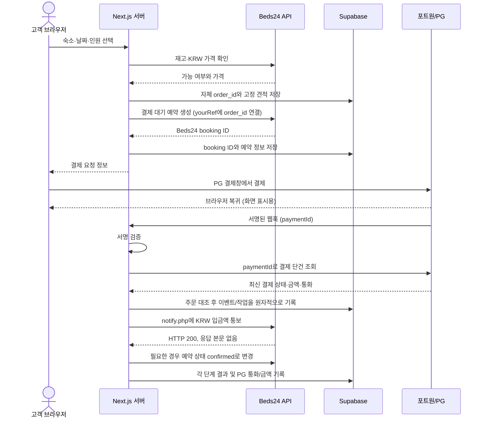

# Beds24 + 자체 결제 연동 흐름 검토안

> 문서 상태: 설계 검토용 초안. 운영 코드나 확정된 사양이 아니다. 2026-10-30 기준으로 사용자가 제공한 Beds24 지원팀 안내와 포트원 공식 V2 문서를 대조했다. 실제 Beds24 API 호출 형식과 PG 통화 지원은 테스트 계정/계약 기준으로 별도 확인해야 한다.

## 먼저 결론

전체 방향은 **Beds24에서 예약과 KRW 요금을 관리하고, 결제사 결제 결과를 서버가 검증한 뒤 Beds24에 KRW 입금액을 통보하는 구조**가 맞다. 다만 현재 받은 구현 명세는 그대로 코딩하면 안 된다. 웹훅 서명 검증 누락, 포트원 ID 개념 혼동, 재시도 중복 입금 위험, 공개 Cron, 결제 취소 상태 검증 등 핵심 보완이 필요하다.

### 확인된 사실과 아직 확인할 일

| 구분 | 현재 확인된 내용 |
| --- | --- |
| Beds24 통보 테스트 | 사용자가 보여준 응답에서 `notify.php` 호출이 성공했고, Beds24 인보이스에 KRW 1,000 결제가 반영됐다. 이로써 테스트한 key/bookid/amount 조합의 기본 통보 경로는 확인됐다. |
| Beds24 통화 | 지원팀 안내상 `notify.php`에는 별도 통화 필드가 없고, 예약에 기록된 통화 기준 금액을 보내야 한다. KRW 예약이면 KRW 입금액을 보낸다. |
| 포트원 웹훅 검증 | V2 웹훅은 서명 검증 후 `paymentId`로 결제 단건 조회를 하도록 공식 예제가 안내한다. 현재 Desktop 가이드 코드에는 서명 검증 단계가 없다. |
| 포트원 ID | V2 `paymentId`는 고객사가 결제 요청 때 정하는 주문 식별자다. PG사가 발급하는 거래번호와 다르다. 결제 시도별 `transactionId`, PG 거래번호(TID)도 별도 식별자다. |
| 아직 미검증 | 포트원 `customData`가 실제 선택 채널의 결제 조회 응답에 보존되는지, USD 결제를 해당 PG/계정이 지원하는지, Beds24에서 같은 `txnid` 재전송이 중복 인보이스를 만들지, 예약 상태 변경 API의 정확한 형식은 추가 확인이 필요하다. |

> 기존 1,000원 테스트는 `notify.php` 기본 성공과 인보이스 반영을 입증한다. 웹훅 서명, 자동 재시도, 동일 거래 ID 중복 통보 방지, 예약 상태 전이, 실제 PG 환불까지 검증한 것은 아니다.

## 목표 흐름



브라우저 복귀 화면은 결제 성공의 증거로 사용하지 않는다. 서버는 서명된 웹훅을 받고 포트원 API에서 최신 결제 상태를 확인한 뒤 처리한다. 웹훅이 브라우저 복귀보다 먼저 또는 나중에 도착할 수 있다.

## 단계별 처리

### 1. 서버에서 견적 확정

- 클라이언트가 보낸 요금·통화 값을 신뢰하지 않는다.
- Next.js 서버가 Beds24에서 해당 숙소/날짜의 재고와 가격을 조회하고, 적용할 보증금 및 환율 정책을 계산한다.
- 주문 테이블에 변경 불가능한 견적 스냅샷을 저장한다: Beds24 가격(KRW), Beds24에 통보할 보증금(KRW), 실제 PG 청구 금액/통화, 환율과 적용 시각, 수수료 정책.
- USD 청구액을 KRW에서 계산한다면 반올림 규칙, 환율 출처/고정 시점, 환불 시 환율 적용 기준을 정하고 주문별로 보존한다.
- USD 결제 가능 여부는 설계만으로 단정할 수 없다. 선택한 PG 채널, 가맹점 계약, 정산 계정이 USD 청구를 허용하는지 확인한다. USD와 KRW를 동시에 받는 방식은 PG/포트원 설정 검증 뒤에 확정한다.

### 2. 주문 ID와 Beds24 예약 연결

서버가 `order_id`를 먼저 만든다. 이것을 내부 DB의 기본 식별자로 쓰고, 가능한 경우 Beds24 `yourRef`와 포트원 `paymentId`에도 같은 값을 전달해 일관되게 연결한다. 외부 필드의 길이/문자 제약은 구현 전에 해당 API 문서로 확인한다.

식별자는 이름과 용도를 구분한다:

| 필드 | 의미 |
| --- | --- |
| `order_id` | 우리 서버가 발급한 주문 ID |
| `portone_payment_id` | 포트원 결제 ID. 결제 요청 시 고객사가 지정하는 값이며 주문 연결 키로 사용할 수 있다. |
| `portone_transaction_id` | 포트원이 결제 시도마다 발급하는 ID. 재시도 결제 시 달라질 수 있다. |
| `pg_tx_id` | 실제 PG사가 발급한 거래번호/TID. 포트원 결제 ID와 별도다. |
| `beds24_booking_id` | Beds24 예약 ID. `notify.php`의 `bookid`에 넣는다. |

현재 가이드의 `pg_payment_id`는 의미가 모호하다. 이를 포트원 `paymentId`에 쓴다면 `portone_payment_id`로 이름을 바꾸고, 거래 시도 ID와 PG TID를 별도 필드로 둔다. `customData`를 주문 연결의 유일한 수단으로 삼지 않는다. 포트원 V2 `paymentId` 자체가 고객사 주문 식별자다.

### 3. 결제 완료 검증

웹훅 처리기는 다음을 수행한다:

1. 요청 원문(body)과 헤더로 포트원 V2 웹훅 서명을 검증한다. 서명 검증 실패는 거부한다.
2. 지원하는 결제 이벤트만 처리하고, 알 수 없는 이벤트는 안전하게 무시한다. 결제 완료 처리는 `Transaction.Paid` 이벤트를 기준으로 한다.
3. 웹훅 안의 `data.paymentId`로 포트원 결제 단건 조회 API를 호출한다.
4. 조회 결과에서 `status === PAID`, 상점/환경, 주문 ID, 실제 결제 금액과 통화를 확인한다.
5. 서버 DB에 저장한 기대 금액·통화와 정확히 대조한다. 외화 결제라면 주문별로 기록한 PG 청구액/통화와 비교하고, Beds24 통보액은 별도의 KRW 견적 스냅샷에서 가져온다.
6. 멱등 키/DB 제약으로 동일 결제 이벤트가 여러 번 와도 주문 처리가 한 번만 시작되게 한다.

현재 Desktop 가이드 코드처럼 웹훅 JSON을 바로 신뢰하고 조회만 하는 것은 부족하다. PortOne 공식 V2 예제는 서명 검증과 결제 단건 조회를 모두 포함한다.

### 4. Beds24 입금 통보와 예약 확정

사용자가 제공한 Beds24 지원팀 답변 기준 `notify.php` POST는 다음과 같다:

```text
key              Custom Gateway Key
bookid           Beds24 booking ID
amount           예약 통화 기준 입금액 (현재 KRW)
txnid            이 결제를 식별하는 고유 거래 ID
description      선택: 인보이스 설명
payment_status   선택: 인보이스 결제 상태
status           선택: 예약 상태 (0 cancelled, 1 confirmed, 2 new, 3 request, -2 no change)
```

통화 필드는 보내지 않는다. 현재 예약 통화가 KRW이므로 `amount`는 예약에 실제로 기록된 KRW 보증금액이어야 한다. 실제 PG에서 USD를 청구했다면 USD 청구액, USD 통화, 적용 환율, 환불액은 우리 DB에 별도로 보관한다.

권장 순서는 입금 통보와 예약 확정을 별도 단계로 추적하는 것이다. `notify.php`에 `status=-2`로 통보한 뒤, 필요하면 Beds24 API로 상태를 확정한다. 또는 통보 시 `status=1`을 함께 보낼 수도 있지만, 그 동작과 이메일/상태 영향은 현재 테스트 결과만으로 확정할 수 없으므로 사전 검증한다. 두 방식을 중복 적용하지 않는다.

## 재시도와 중복 방지: 가장 중요한 운영 위험

DB와 Beds24 사이에는 하나의 원자적 트랜잭션이 없다. 서버가 Beds24에 POST를 보낸 뒤 응답을 받기 전에 연결이 끊기면, 입금이 반영됐는지 서버만으로는 알 수 없다. 이 상태에서 새 `txnid`로 무조건 재전송하면 중복 입금이 생길 수 있다.

- 모든 재시도에서 동일한 결제에 동일한 `txnid`를 쓴다.
- Beds24가 같은 `txnid`를 중복 제거하는지, 동일 금액을 다시 더하지 않는지 확인한다. 사용자 제공 지원 답변은 고유 `txnid`로 중복 처리를 방지할 수 있다고 했지만, 실제 반복 POST 결과는 별도 테스트가 필요하다.
- 통보 결과가 불명확하면 새 거래로 간주하지 않는다. 먼저 Beds24 예약/인보이스를 조회해 반영 여부를 대조한다. 조회 API로 확인할 수 없다면 운영자 검토 상태로 보내고 자동 재전송을 멈춘다.
- Supabase 주문 상태 변경은 조건부 업데이트/DB 함수로 원자화하고, 외부 HTTP 호출과 DB 트랜잭션을 길게 묶지 않는다.
- 재시도 작업은 웹훅과 Cron이 동시에 같은 주문을 처리하지 못하도록 원자적 claim/lease를 사용한다.

## 상태 모델 제안

`PROCESSING` 한 상태만으로는 외부 단계가 어디까지 끝났는지 알기 어렵다. 최소한 결제 검증, Beds24 입금 통보, 예약 상태 변경의 결과를 나눠 저장한다.

```text
PENDING_PAYMENT
  -> PAYMENT_VERIFIED
  -> BEDS24_NOTIFY_PENDING
  -> BEDS24_DEPOSIT_RECORDED
  -> BOOKING_CONFIRM_PENDING
  -> COMPLETED

BEDS24_NOTIFY_PENDING -> BEDS24_NOTIFY_UNKNOWN  (요청 결과를 확인할 수 없음)
BEDS24_NOTIFY_PENDING -> BEDS24_NOTIFY_FAILED   (Beds24가 명시적으로 거절)
BOOKING_CONFIRM_PENDING -> CONFIRM_FAILED

PENDING_PAYMENT -> EXPIRED / CANCELLED
EXPIRED 또는 CANCELLED 뒤 결제가 확인됨 -> REFUND_PENDING -> REFUNDED / REFUND_FAILED
금액/통화 불일치 -> REVIEW_REQUIRED 또는 REFUND_PENDING
```

입금 통보가 이미 성공한 `CONFIRM_FAILED`에서는 `notify.php`를 다시 호출하지 않고 예약 상태 변경만 재시도한다. 통보 결과가 모호한 `BEDS24_NOTIFY_UNKNOWN`은 같은 거래 ID 중복 처리를 검증하기 전까지 자동으로 새 통보를 반복하지 않는다.

## 현재 코드 초안에서 수정할 점

1. **웹훅 서명 검증 추가**: 지금 코드에는 검증이 없다. 원문 body/헤더를 이용해 PortOne V2 SDK로 검증한다.
2. **ID 설명과 컬럼 분리**: `paymentId`는 고객사 지정 결제 ID다. PortOne `transactionId`와 PG TID를 혼동하지 않는다.
3. **Cron 인증**: 현재 GET Cron은 인증이 없다. 강한 비밀값을 검증하거나 플랫폼의 보호된 스케줄러 인증을 적용하고, GET 대신 의도된 실행 메서드를 제한한다.
4. **경합 방지**: 웹훅과 Cron이 같은 행을 가져와 중복 외부 호출하지 않도록 원자적 claim과 처리 lease를 둔다.
5. **Cron 페이지 제한**: 처리 건수 상한, 페이지네이션, 재시도 횟수/다음 실행 시각을 둔다.
6. **실패 재시도 결제 재검증**: `FAILED_NOTIFY` 재시도 전에 포트원 단건 조회를 다시 해 현재도 `PAID`인지, 취소되지 않았는지 확인한다.
7. **취소 성공 판정**: HTTP 200만으로 환불 완료라고 처리하지 않는다. 응답의 취소 상태가 성공인지 확인하고, 비동기 취소 상태도 분기한다.
8. **위변조/지각 결제 상태 전이**: 어떤 상태에서도 무조건 환불하는 코드로 두지 않는다. PG 결제 상태·금액·통화·취소 가능액과 실제 취소 응답을 검증하고 중복 환불을 막는다.
9. **상태 전이 충돌**: 코드에서 `CONFIRM_FAILED`를 먼저 처리하는데, 그 전에 결제 상태/금액/통화가 같은 주문과 일치하는지 다시 확인한다. 주문 매핑 일치만으로 확정 재시도하지 않는다.
10. **HTTP 응답 정책**: 포트원 V2는 네트워크/오류 응답 시 최대 5회 재전송을 하지만 이것만 복구 수단으로 삼지 않는다. 자체 inbox/outbox 및 조정 작업을 둔다.

## 권장 구현 순서

1. Supabase 주문 테이블/상태/유일 제약과 서버 견적 스냅샷을 확정한다.
2. Beds24 예약 생성 및 `yourRef` 연결을 테스트한다.
3. 포트원 테스트 결제 시작을 붙이고 `paymentId`를 주문 ID에 고정한다.
4. 웹훅 서명 검증 + 단건 조회 + 금액/통화 대조까지만 구현한다. 이 단계에서 Beds24 입금 통보는 아직 호출하지 않는다.
5. 확인된 결제만 Beds24 `notify.php`에 통보하고, 동일 `txnid` 반복 테스트를 한다.
6. 예약 상태 변경, 실패 복구, 취소/환불 흐름을 추가한다.
7. 인증된 Cron/워커, 로그/운영 알림과 대사 화면을 붙인다.
8. 테스트 모드에서 정상, 중복 웹훅, 웹훅 지연, 통보 timeout, 상태 변경 실패, 만료 후 늦은 결제, 금액/통화 불일치를 검증한다.

## 지금 확인이 필요한 결정

- 외국인 USD 결제를 어떤 PG/가맹점 경로로 받을지, 그 채널이 실제 USD 승인/정산을 지원하는지.
- 고객에게 보여줄 환율과 수수료 및 취소/환불 환율 기준.
- Beds24 `notify.php` 통보가 자동으로 예약 상태를 바꿀지, 상태는 별도 API로만 확정할지.
- Beds24가 같은 `txnid` 반복 POST를 어떻게 처리하는지에 대한 실제 반복 테스트.
- Beds24 API 예약 생성/상태 변경 엔드포인트의 현재 V2 요청 형식과 API 토큰 권한.

## 참고 문서

- PortOne V2 웹훅 연동 및 서명 검증 예제: https://developers.portone.io/opi/ko/integration/webhook/readme-v2?v=v2
- PortOne 결제 ID와 PG 거래번호 용어: https://developers.portone.io/opi/ko/support/pg-terms?v=v2
- PortOne V2 결제 단건 조회 API: https://developers.portone.io/api/rest-v2/payment?v=v2
- Beds24 `notify.php` 파라미터는 사용자가 전달한 Beds24 지원팀 답변을 기준으로 작성. 계정별 실제 설정은 해당 계정에서 재확인.

---

## 2026-10-30 최신 Desktop 가이드 v2.0 재검토

최신 파일 `C:\Users\aabbcc\Desktop\BEDS24_INTEGRATION_GUIDE.md` (2026-10-30 17:21 수정, 29,278 bytes)를 읽었다. 이전 검토의 핵심 일부는 반영됐지만, 아래 코드 수준의 문제 때문에 여전히 실행 가능한 구현 명세로 간주하면 안 된다. Desktop 원본은 수정하지 않았다.

### 반영된 개선

- `paymentId`를 주문 ID로 고정하고 PortOne transaction ID와 구분하려는 방향.
- 브라우저 복귀를 결제 근거로 쓰지 않고, 웹훅 서명 검증 및 결제 단건 조회를 추가한 방향.
- Cron 인증과 조회 건수 제한을 명시한 점.
- `notify.php` 타임아웃을 결과 불명 상태로 분리하고 동일 `txnid` 재통보를 경계한 점.

### 먼저 고칠 구현 오류

1. **직접 작성한 PortOne 서명 검증 함수는 사용하지 말 것.** 가이드의 함수는 헤더에서 `webhook-signature` 값을 통째로 하나의 Base64 서명으로 취급한다. Standard Webhooks 서명 형식/키 처리/복수 서명 헤더/타임스탬프 허용 범위와 호환되는지 보장되지 않으며, `timingSafeEqual`은 길이가 다르면 예외를 낼 수 있다. 포트원 공식 JS 서버 SDK의 웹훅 검증 함수를 사용하고, 원문 body와 headers를 전달한다. 공식 가이드도 SDK 사용을 예시로 든다.
2. **Beds24 `notify.php` HTTP 200 응답 본문도 검사할 것.** 공식 Beds24 문서에 따르면 성공 응답은 HTTP 200이며 본문이 비어 있고, 본문 텍스트가 있으면 오류다. 현재 클라이언트는 `!res.ok`만 검사하므로 HTTP 200 + 오류 텍스트를 입금 성공으로 기록할 수 있다. 빈 본문인지 검사하고, 예상하지 못한 응답은 성공으로 간주하지 않는다.
3. **환불 성공 판정 로직 수정.** `data.cancellation?.status === 'SUCCEEDED' || res.status === 200`은 HTTP 200이면 어떤 취소 상태든 성공으로 처리한다. 상태를 확인한다는 주석과 코드가 모순된다. 비동기 취소 대기/실패/성공 상태를 API 응답에 맞춰 각각 기록하고, 요청 멱등 키와 환불 claim을 둔다.
4. **Cron에는 인증 외에 작업 claim이 필요.** `limit(50)`만으로는 잠금이 되지 않는다. 같은 Cron이 중복 실행되거나 웹훅과 겹치면 같은 주문을 동시에 처리할 수 있다. 두 쿼리 모두 원자적 claim/lease, 소유자 토큰 또는 fencing token, 재시도 횟수와 `next_retry_at`을 사용해야 한다. 5분이 지난 PROCESSING을 다시 가져오는 경우에도 이전 작업자가 살아 있을 수 있어 lease 시간만으로 중복 외부 POST를 막을 수 없다.
5. **FAILED_NOTIFY Cron의 포트원 응답 검증 누락.** `pgRes.ok` 확인 없이 `json()`을 호출하며, 재조회 결과의 결제 ID·금액·통화도 주문 견적과 다시 대조하지 않는다. 실패한 조회나 바뀐/취소된 결제는 Beds24로 보내지 않아야 한다.
6. **식별자와 DB 컬럼명이 서로 다름.** 표에서는 `portone_transaction_id`를 `orders.portone_tx_id`에 저장한다고 하고, 코드에서는 `pg_tx_id`/`pg_payment_id`를 쓴다. `payment.transactionId || payment.pgTxId || paymentId`도 서로 다른 ID 종류를 한 컬럼으로 섞는다. `paymentId`, PortOne transaction ID, 실제 PG TID를 각기 별도 컬럼에 넣고, 모르면 null로 둔다. 포트원 `paymentId`를 PG TID의 대체값으로 쓰지 않는다.
7. **CONFIRM_FAILED 분기 위치와 유효성 검증.** 이 분기는 금액/통화 대조보다 먼저 실행된다. DB 행이 손상되거나 결제 ID가 잘못 연결된 경우에도 Beds24 예약을 확정할 수 있다. 모든 상태 변경 분기 전에 결제 ID, 주문 ID, 예상 금액, 통화, Beds24 예약 ID 매핑을 검증하고, 결제 견적 스냅샷은 변경 불가능하게 보관한다.
8. **알 수 없는 통보 결과를 자동 성공 처리하지 말 것.** `BEDS24_NOTIFY_UNKNOWN`은 인보이스 확인만으로 `COMPLETED`로 바꾸면 안 된다. 입금이 확인되면 `DEPOSIT_RECORDED`로 옮기고, 예약 확정까지 성공한 뒤에만 `COMPLETED`로 전이한다. 인보이스를 API로 확인할 수 없는 경우 자동 재전송을 멈추고 운영자 확인으로 보낸다.
9. **Custom Gateway 설정을 이 흐름의 필수 설정처럼 제시하지 말 것.** 문서의 서버가 직접 Beds24 API로 예약을 만들고 자체 결제창을 여는 구성과, Beds24 예약 페이지의 Custom Gateway가 고객을 `/pay`로 보내는 구성은 서로 다른 진입 경로다. 실제로 Beds24 예약 페이지를 결제 진입점으로 쓸 때만 URL/Post data 설정이 필요하다. `notify.php` key는 Beds24 Custom Gateway 설정의 key와 일치해야 하지만, 미사용 게이트웨이를 높은 우선순위로 켜는 것은 별도 판단이다.
10. **예시 키를 실키처럼 복사하지 않게 표시.** `my_secret_key_2026`은 문서 예시 문자열일 뿐이다. 저장소/문서에 실제 값이나 재사용 가능한 예시 비밀값을 넣지 않고, 환경별로 안전하게 생성·보관한다.

### 구현 계약으로 확정하기 전에 검증할 것

- PortOne 웹훅은 공식 SDK로 서명 검증하고, 설정된 웹훅 버전의 이벤트 스키마와 헤더를 테스트한다. 공식 V2 가이드는 서명 검증과 단건 조회를 함께 예시한다.
- Beds24 `notify.php`의 HTTP 200 + 빈 본문, HTTP 200 + 오류 본문, 동일 `txnid` 재전송 각각을 테스트한다. Beds24 문서상 `txnid`는 중복 결제 통보 방지용 고유값이다.
- Beds24 API 경로/필드/응답은 현재 API V2 Swagger 스키마와 대조한다. 가이드 코드의 `created = data[0]`, `created.success`, 예약 가격/방 필드 이름은 실제 응답을 이용한 검증 전까지 확정하지 않는다.
- 포트원 결제 요청의 `paymentId` 길이/문자 제한과 각 PG 채널의 USD 청구 지원은 선택한 채널 기준으로 확인한다.
- 상태 머신의 `COMPLETED`는 PG PAID + Beds24 입금 기록 확인 + 필요한 예약 상태 확정이 모두 끝난 때만 사용한다.

공식 참고: [PortOne V2 웹훅 검증 안내](https://developers.portone.io/opi/ko/integration/webhook/readme-v2?v=v2), [PortOne ID 용어](https://developers.portone.io/opi/ko/support/pg-terms?v=v2), [Beds24 Custom Gateway / notify.php](https://wiki.beds24.com/wikitest/index.php/Custom_Gateway), [Beds24 API V2](https://wiki.beds24.com/index.php?title=Category%3AAPI_V2).

### 2026-10-30 Desktop v2.1 추가 검토

최신 Desktop 파일은 17:31 수정, 30,254 bytes였다. v2.1은 응답 본문 검사와 Cron claim 시도를 반영했으나, 다음 부분은 아직 수정이 필요하다.

1. **SDK 사용 코드가 공식 문서 예시와 다르다.** 가이드의 `import { PortOne }`, `PortOne({ secret })`, `portone.webhook.verify(...)` 형태는 공식 웹훅 예제의 `import * as PortOne`, `PortOne.PortOneClient(secret)`, `PortOne.Webhook.verify(secret, rawBody, headers)` 형태와 일치하지 않는다. 사용하려는 SDK 버전의 실제 export/API를 확인하고 공식 예제에 맞춰야 한다. 현재 코드가 바로 컴파일된다고 가정하지 않는다.
2. **FAILED_NOTIFY Cron에서 PG 재조회가 빠졌다.** v2.0에는 있었던 재조회가 v2.1 코드에서 사라졌다. 실패 통보를 재시도하기 직전에 PortOne 응답의 HTTP 성공 여부, PAID 상태, 결제 ID, 금액, 통화를 다시 검증해야 한다.
3. **선점 락은 있지만 소유권/백오프가 없다.** Cron은 행을 `PROCESSING`으로 바꾸지만 `claim_token`, `lease_until`, 재시도 횟수, `next_retry_at`이 없다. 실패 시 상태만 원복해 즉시 다음 Cron이 또 집을 수 있고, 오래 걸린 이전 실행이 늦게 돌아와 새 실행 결과를 덮을 수 있다. 조건부 완료 업데이트와 fencing/소유자 토큰을 추가한다.
4. **UNKNOWN 상태 복구 경로가 구현되지 않았다.** 상태도에는 `BEDS24_NOTIFY_UNKNOWN`을 넣었지만 Cron은 `CONFIRM_FAILED`와 `FAILED_NOTIFY`만 읽는다. UNKNOWN은 invoice 조회로 실제 반영을 대조하고, 확인된 경우 입금 기록 완료 단계로 옮긴 뒤 예약 확정해야 한다. 직접 `COMPLETED`로 넘기지 않는다.
5. **`txnid`에 PortOne ID를 섞는 fallback 제거.** `payment.transactionId || payment.pgTxId || paymentId`는 다른 종류의 ID를 하나로 합치고, 조회 응답에 원하는 필드가 없을 때 결제 ID를 PG 거래번호처럼 사용한다. Beds24 통보용 안정된 고유 ID를 주문의 결제/입금 통보 레코드에서 생성해 재시도에 계속 재사용한다. PG TID가 실제 조회 결과에서 확인될 때만 별도 필드에 저장한다.
6. **Custom Gateway를 필수 활성화하라는 단정은 근거가 부족하다.** 사용자가 자체 사이트에서 결제하고 서버가 `notify.php`만 호출한다면, Beds24 예약 페이지에서 외부 결제 URL로 보내는 설정은 별도 진입 경로다. 또한 URL/Post data에 임의 주소를 넣어도 무관하다는 표현은 안전하지 않다. Beds24가 요구한 key 값은 계정 설정에서 확인하되, 게이트웨이 활성화/우선순위와 URL/Post data는 실제 Beds24 예약 페이지에서 이 경로를 사용할지에 따라 설정한다.
7. **Beds24 API 호스트·응답 스키마 확인 필요.** 코드의 `https://api.beds24.com/v2/...` 경로, 예약 생성 응답이 배열의 첫 항목이며 `{ success, id }`를 가진다는 가정, `price` 필드 등은 API V2의 현재 공식 Swagger와 실제 테스트 응답으로 확인해야 한다. 인증 refresh token은 `/authentication/token`에서 새 access token을 만들고, API 요청에는 refresh token이 아닌 access token을 `token` 헤더로 전달해야 한다.
8. **결제 이벤트 누락/잘못된 이벤트 처리.** `if (webhookPayload.type && type !== 'Transaction.Paid')`는 `type`이 없을 때도 아래 결제 처리로 진행한다. 설정한 웹훅 버전의 필수 필드(`type`, `data.paymentId`, `storeId`)를 검증하고, 누락/미지원 이벤트는 결제 처리로 흘러가지 않도록 한다.
9. **결제 취소는 중복 실행과 비동기 상태를 추적해야 한다.** PortOne 취소 요청 전에 DB에서 환불 작업을 선점하고, API 응답의 `SUCCEEDED` 외 상태를 구분한다. 요청 timeout 뒤 재시도는 같은 멱등 키를 사용하고, 취소 대기 상태를 실패로 오인하지 않도록 한다.
10. **Booking Rules 테스트 항목은 이미 별도 운영 검증 항목이다.** 구현 문서에서는 상태 차단 설정을 확정된 API 기능처럼 쓰지 말고 설정 요구와 실제 확인 결과를 구분한다.

포트원 공식 V2 문서는 JS 서버 SDK 설치와 검증 예제를 안내하며, Beds24 API V2는 access token을 `token` 헤더로 전달한다고 설명한다. 이 내용은 [PortOne 웹훅 예제](https://developers.portone.io/opi/ko/integration/webhook/readme-v2?v=v2)와 [Beds24 API V2 문서](https://wiki.beds24.com/index.php?title=Category%3AAPI_V2)에 근거한다.

### 2026-10-30 Desktop v2.3 추가 검토

최신 Desktop 파일은 17:39 수정, 49,892 bytes였다. 상태 설계는 더 상세해졌지만, 표지의 “운영 표준/Production Hardened” 표시는 아직 적절하지 않다. 아래는 실제 배포 전에 해결해야 할 구체적인 차단 항목이다.

1. **PortOneClient 생성자 호출이 공식 예제와 다르다.** 현재 코드에서는 `PortOne.PortOneClient({ secret: ... })`를 사용하지만 포트원 공식 웹훅 예시는 `PortOne.PortOneClient(process.env.PORTONE_API_SECRET)`처럼 secret 문자열을 직접 넘긴다. SDK 타입/API에 맞게 수정하고 설치한 버전으로 타입 검사해야 한다. 그렇지 않으면 `.payment.getPayment`/`.cancelPayment`를 쓰기 전에 초기화에서 실패할 수 있다.
2. **DDL이 문서의 생성 순서를 막는다.** 흐름은 DB 주문을 먼저 만든 뒤 Beds24 예약을 만들고 `beds24_booking_id`를 나중에 바인딩한다. 그런데 DDL은 `beds24_booking_id BIGINT NOT NULL`이다. 주문 생성 시 insert가 실패한다. 예약 생성 완료 전에는 NULL 허용 후 조건부 바인딩하거나, 생성 순서를 바꾸고 중간 실패 보상 절차를 정의해야 한다. `portone_payment_id`도 1:1 매핑이면 UNIQUE 제약이 필요하다.
3. **UNKNOWN 인보이스 매칭이 동일 금액으로 오판할 수 있다.** `matchTxn || matchAmount`는 같은 예약에 같은 금액의 다른 입금이 있어도 이번 결제가 반영됐다고 판단할 수 있다. `description`은 기본 문구만 보내므로 `notify_txnid`가 실제 인보이스에 기록된다는 근거도 없다. Beds24 조회 결과에서 고유 거래 ID를 실제로 얻을 수 있는지 먼저 확인하고, 정확한 식별이 안 되면 금액만으로 자동 판정/재통보하지 말고 운영자 확인으로 격리해야 한다.
4. **Beds24 인보이스 조회 파라미터/응답 필드 확인 필요.** 코드의 `includeInvoice=true`, `invoiceItems || invoice`, `inv.type`/`inv.amount` 필드는 공식 API V2 스키마와 실제 응답으로 검증해야 한다. Beds24 문서 예시는 인보이스 항목을 포함할 때 `includeInvoiceItems=true`를 사용한다. 잘못된 쿼리면 조회에 성공해도 인보이스가 빠져 UNKNOWN이 계속 오판될 수 있다. ([Beds24 API V2 안내](https://wiki.beds24.com/index.php?title=Category%3AAPI_V2))
5. **예약 생성과 수정은 HTTP 상태만 확인하면 부족하다.** `updateBeds24Booking`과 `cancelBeds24Booking`은 응답 JSON의 예약별 성공/실패를 검사하지 않고 반환한다. API가 HTTP 200으로 예약별 오류를 반환하면 코드가 예약 확정/취소를 성공으로 기록할 수 있다. Beds24 응답 스키마에 맞춰 각 항목의 성공 필드를 검사한다.
6. **환불 비동기 상태 처리가 완성되지 않았다.** 만료 결제는 `REQUESTED`면 `REFUND_PENDING`에 남지만, 웹훅은 `Transaction.Paid`만 처리하고 Cron은 REFUND_PENDING을 조회하지 않아 최종 취소 결과를 반영하지 못한다. 위변조 환불 분기에서는 `REQUESTED`를 `TAMPERED_REFUND_FAILED`로 오분류한다. 취소 이벤트와 주기적 결제 조회를 포함한 환불 조정 작업이 필요하다.
7. **`cancellationId`를 멱등 키처럼 사용한다고 볼 수 없다.** 코드는 `cancellationId`를 매번 `${Date.now()}`로 새로 생성해 취소 요청에 보낸다. 이것은 재시도 때 값이 바뀌며, 포트원 공식 취소 입력 필드/멱등성 계약과 맞는지도 확인되지 않았다. API의 실제 입력 스키마와 idempotency 지원을 확인하고 같은 환불 작업의 재시도 키를 안정적으로 유지한다.
8. **웹훅 stale lease 재선점은 외부 호출을 막지 못한다.** 5분 지난 `PROCESSING`을 새 웹훅이 다시 claim할 수 있다. 이전 작업자가 Beds24 POST를 이미 보냈거나 계속 실행 중이면 외부 부작용이 중복될 수 있다. claim_token은 DB 쓰기만 펜싱한다. Beds24의 동일 `txnid` 중복 방어를 실측하고, 만료 lease에 대한 회수 절차와 외부 처리 결과 대사를 설계해야 한다.
9. **상태 변경 결과를 Supabase에서 확인하지 않는 구간이 있다.** 예를 들어 Beds24 notify 성공 뒤 `deposit_status` 업데이트 오류를 확인하지 않고 상태 변경을 계속한다. 여러 update 호출은 오류를 반환해도 무시될 수 있어 DB가 `COMPLETED`인데 입금 상태는 미기록인 부분 성공이 생긴다. 모든 DB 쓰기 결과를 검사하고, 외부 단계별로 outbox/상태 전이를 기록한다.
10. **Cron claim token은 주문마다 생성하고 처리 시간에 맞게 lease를 설정해야 한다.** 현재 한 번 만든 `claimToken`/`leaseUntil`을 한 실행에서 여러 주문에 공통 사용한다. 주문 ID 조건이 있어 즉시 교차 갱신되는 문제는 제한되지만, 이는 per-job 소유권 토큰이 아니고 오래 걸리는 batch에서 lease가 먼저 만료될 수 있다. 주문마다 개별 claim token과 만료를 만들고, 갱신 및 소유권 조건을 모든 완료/실패 업데이트에 적용한다.
11. **Secret과 테스트 키의 운용 기준을 분명히 한다.** Custom Gateway의 key가 `notify.php` 통보에 필요하다는 점과 gateway를 Enabled/highest로 노출해야 한다는 점은 서로 다른 설정이다. 현재 문서는 자체 사이트 결제인데도 어느 설정은 필수라고 하고 URL/Post data는 임의 주소여도 무관하다고 단정한다. 실제 Beds24 계정 동작을 확인하기 전에는 URL/Post data를 임의 값으로 설정하라고 안내하지 않는다.
12. **통화/금액 정밀도와 PG 지원은 가정으로 확정하지 않는다.** KRW 정수와 USD 소수 금액을 단일 `NUMERIC(12,2)`/JavaScript Number로 비교한다. 최소 통화 단위 정수 또는 Decimal 기반 저장/검증이 안전하다. 각 PortOne 채널이 USD를 승인하고 실제 정산할 수 있는지도 채널/계약별로 확인해야 하므로 “Production”으로 분류할 수 없다.

이 검토는 구조와 문서/코드의 일관성 점검이다. Desktop 파일의 코드가 실제 프로젝트에 구현됐거나 빌드·테스트를 통과했다는 의미는 아니다. PortOne의 공식 JS 예제는 client 생성자에 secret 문자열을 전달하는 형태이며, Beds24 V2 안내는 API 요청에 access token을 `token` 헤더로 전달하고 인보이스 항목 포함 옵션을 구체적으로 확인하도록 해야 한다.

### 2026-10-30 Desktop 최신 사본 재확인 (17:44)

파일이 53,318 bytes로 늘었지만 헤더는 여전히 v2.3이며, 핵심 코드 문제는 해결되지 않았다. 추가 내용으로 환율 계산 예시와 notify 파라미터 표가 들어갔다.

- 환율 유틸의 `exchangeRate = 1400.0`은 예시 값이 함수 기본값으로 들어가 있어 실수로 운영 적용될 수 있다. 환율 제공자, 최신성, 수수료/마진, 환불/취소 정책을 확정하기 전에는 기본값을 제거하고 외부 설정/서버 계산 결과를 필수로 받게 해야 한다. 금액 계산은 부동소수점 대신 통화별 최소 단위/Decimal로 한다.
- `notifyBeds24CustomPayment`의 `txnid`가 optional이고 빠지면 `TEST_${Date.now()}`를 생성한다. 이는 문서의 “항상 같은 notify_txnid를 재사용” 규칙과 정면으로 모순된다. 운영 함수에서는 txnid를 필수 인자로 만들고 자동 생성 fallback을 제거한다. 테스트용 호출은 별도 함수/명시적 테스트 모드로 격리한다.
- `notify.php` 파라미터 표는 `amount`와 `txnid`를 공식 필수 필드로 표시했지만 Beds24 문서상 필수는 `key`, `bookid`이고 나머지는 선택 필드다. 이 애플리케이션에서 두 필드를 내부 필수 계약으로 요구할 수는 있지만 “Beds24 공식 필수”와 “우리 구현에서 필수”를 구분한다. ([Beds24 Custom Gateway 안내](https://wiki.beds24.com/wikitest/index.php/Custom_Gateway))
- 인보이스 조회는 여전히 `includeInvoice=true`이고, 공식 API 안내에서 확인되는 `includeInvoiceItems=true`와 다르다. 더구나 UNKNOWN 매칭은 고유 거래 ID 또는 금액 중 하나만 맞으면 성공으로 판단해 동일 액수의 다른 입금과 구분하지 못한다. 고유 거래 ID를 실제 invoice item에서 읽을 수 없으면 amount-only 자동 매칭을 제거한다.
- DDL의 `beds24_booking_id NOT NULL`과 “DB 주문 먼저, Beds24 예약 후 ID 바인딩” 순서 충돌, PortOneClient 생성자 인자 모양 불일치, 예약별 API 응답 검증 누락은 그대로 남아 있다.
- 웹훅의 notify 예외 처리부는 모든 실패를 `BEDS24_NOTIFY_UNKNOWN`으로 저장한다. 상태도/설명은 명시적 거절을 `FAILED_NOTIFY`로 구분하지만 코드가 그 분기를 만들지 않는다. timeout/연결 종료처럼 결과가 불명확한 경우와 Beds24가 오류 본문으로 명시 거절한 경우를 분류해야 한다.
- 환불 응답 `REQUESTED`는 일반 지각 결제에서만 pending으로 유지된다. 위변조 금액 분기에서는 `REQUESTED`도 실패로 기록한다. 또한 `REFUND_PENDING` 및 `TAMPERED_REFUND_PENDING`의 후속 상태를 확인하는 Cron/Webhook 분기가 현재 보이지 않는다.
- 실제 저장소 아키텍처도 결정되지 않았다. 이 저장소는 WordPress/Elementor 전환 중이며, Next.js API를 별도 서비스로 운영할지, 어디에 배포하고 어떻게 WordPress에서 호출할지 문서가 설명하지 않는다. 결제 API 호스팅, 도메인, 환경변수/비밀값 저장, 장애 대응 담당을 결정해야 한다.

따라서 이번 사본도 설계 참고자료로는 유용하지만 “운영 표준 사양서”로 승인하거나 그대로 코드화할 단계는 아니다.

### 2026-10-30 Desktop v2.4 재검토 (17:49)

최신 사본은 56,622 bytes이며 헤더 상태를 `Working Architectural Specification`으로 변경했다. 직전 차단 항목 중 DDL의 nullable Beds24 ID, PortOneClient 문자열 인자, `includeInvoiceItems=true`, amount-only UNKNOWN 매칭 제거, notify txnid 필수화, 환불 폴링과 개별 Cron claim은 반영됐다. 다만 다음 항목은 구현 전 수정/검증이 필요하다.

1. **`CONFIRM_FAILED` 분기가 금액/통화 대조보다 먼저 실행된다.** 웹훅 코드가 해당 상태면 Beds24 상태를 먼저 `confirmed`로 바꾸고 반환한다. 이 분기 전에 `order.expected_amount`/`currency`와 실제 결제 금액/통화를 대조하고, `deposit_status === SUCCESS`와 booking ID도 확인해야 한다. 현재 이 분기는 별도의 claim도 없어 Cron 복구와 웹훅 재전송이 동시에 수행될 수 있다.
2. **FAILED_NOTIFY 재시도에서 통화 대조가 빠져 있다.** Cron은 PortOne `PAID`와 금액은 확인하지만 `payment.currency === ord.currency`를 확인하지 않고 KRW 입금 통보를 보낸다. 주문 ID·금액·통화 모두 다시 확인해야 한다.
3. **`cancellationId`가 포트원의 멱등 키인지 확인되지 않았다.** 문서가 `cancelPayment` 요청 body의 `cancellationId`를 멱등 키라고 설명하지만, PortOne REST 일반 멱등성 규격은 `Idempotency-Key` 요청 헤더를 설명한다. 현재 SDK 입력에 `cancellationId`를 전달하는 게 유효한지, 고정 키를 실제 멱등성으로 처리하는지는 공식 SDK/API 타입을 확인해야 한다. 이름이 같다는 이유로 취소 건 ID를 멱등성 헤더와 동일시하지 않는다. ([PortOne REST API 개요](https://developers.portone.io/api/rest-v2/overview))
4. **Beds24 응답 오류 분류가 여전히 넓다.** 클라이언트는 HTTP 비성공 응답이거나 본문이 있으면 모두 `Beds24NotifyExplicitError`로 던진다. 200 + 오류 문구는 명시 거절로 처리할 수 있지만, 5xx 응답은 요청이 처리됐는지 모호할 수 있다. HTTP 5xx/연결 종료/timeout은 UNKNOWN으로 두고, 문서가 보장하는 명시 오류 응답만 FAILED_NOTIFY로 분리한다.
5. **예약 상태 API 성공 판정 조건이 느슨하다.** `if (!item?.success && !item?.id)`는 `success === false`여도 `id`가 있으면 성공으로 통과한다. 실제 Beds24 응답 스키마에서 명시적 성공 여부를 확인하고, 실패를 나타내는 응답은 ID 유무와 관계없이 거부한다.
6. **UNKNOWN에서 미확인 후 자동 재통보는 중복 제거 동작 확인이 전제다.** 이 경로는 인보이스에서 txnid가 보이지 않으면 동일 txnid로 POST를 다시 보낸다. Beds24 문서가 txnid를 중복 방지 목적으로 설명하지만, 지연 반영/동일 txnid 반복의 계정별 실제 동작은 테스트 전까지 보장된 것으로 취급하지 않는다. 재시도 상한과 운영자 검토 경로는 유지한다.
7. **환율·금액 산술 정밀도:** 하드코딩 환율은 빠졌지만 quote 예시는 JS `number` 산술/반올림을 쓴다. PG·DB 대조는 통화 최소 단위 정수(USD cents, KRW won) 또는 Decimal을 사용하고, 적용할 환율 소스/시각/마진/반올림 정책을 주문 스냅샷으로 고정한다.
8. **아키텍처 배포 경계:** 저장소 기준 사이트는 WordPress/Elementor 전환이 진행 중이다. Next.js API를 별도 서버리스 서비스로 둘지, 실제 호스팅/도메인/웹훅 URL/비밀값 운용을 어떻게 할지 정하지 않으면 이 설계는 마케팅 사이트에 연결될 수 없다. 코드 작성 전 배포 경계를 문서화한다.

현재 판단: v2.4는 이전보다 훨씬 검토 가능한 설계 초안이지만, 아직 “운영 표준”이나 실제 코드로 취급하지 않는다. 특히 CONFIRM_FAILED/FAILED_NOTIFY 검증 순서와 환불 멱등성 계약을 먼저 바로잡는다.
